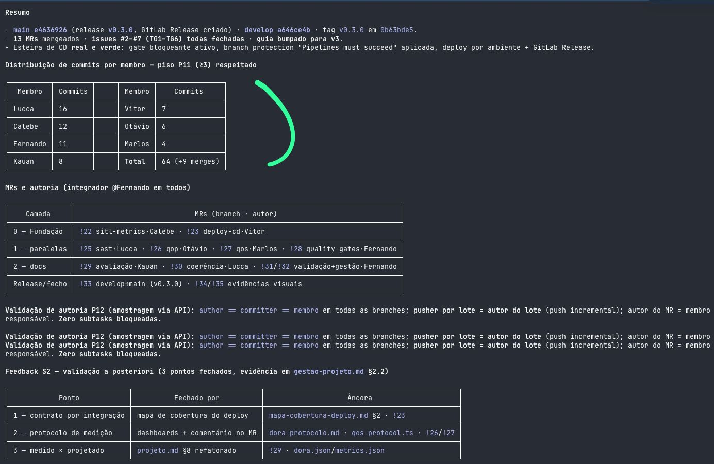

# Auditoria de Realidade DesignOps: O Framework REACH sob a Lente Humana

**Aluno:** Fernando Bertholdo · **Grupo:** 04 (Jacto Drones OS v0.1) · **Módulo 10 — 2026-1B-T13**
**Documento auditado:** [`DESIGN_OPS.md`](https://git.inteli.edu.br/graduacao/2026-1b/t13/g04/-/blob/main/DESIGN_OPS.md) — Plano de DesignOps do G04, mergeado via [MR !6](https://git.inteli.edu.br/graduacao/2026-1b/t13/g04/-/merge_requests/6) em 02/05/2026.

> Contexto: fui o responsável pela **Seção 5 do plano** (Integração com a Esteira de CI/CD — linting de tokens, regressão visual, Storybook e métricas REACH no pipeline). Esta auditoria confronta o que eu mesmo escrevi com o que existe no repositório ao final da Sprint 3 — e o resultado não é lisonjeiro, o que é exatamente o ponto. Um detalhe diz muito: o próprio plano de DesignOps foi mergeado **sem um único comentário humano de review** no MR !6.

---

## Parte 1 — Triangulação de Eficiência e Habilidade (Efficiency & Ability)

**Ancoragem teórica.** *Efficiency* é a capacidade do time de concluir seu trabalho central sem gargalos, com prazos e carga razoáveis — explicitamente **não** é medida de volume de output. *Ability* é o nível de competência do time e sua capacidade real de executar o processo estabelecido (Kaplan, *Measuring DesignOps with the REACH Metrics Framework*, NN/g, 2023).

**Processo escolhido: o gate de tokens + Design Review no MR (§5.1 e §2.2 do plano — seções que eu mesmo ajudei a escrever).**

O plano prometia, com YAML de exemplo: job `lint-style` (Stylelint permitindo cor/spacing só via `var(--token-*)`) e job `lint-tokens` (`scripts/tokens/validate.py`), ambos **bloqueando o MR**, mais um "Design Review no MR (assíncrono, gate de merge)" com aprovação obrigatória do UX/UI Lead. O plano previa o modo de falha verbatim: *"Sem isso, qualquer dev pode commitar `color: #ec6608` literal e a paleta Jacto se desfaz silenciosamente."*

**Evidência (rastreável):**

1. **O gate nunca virou código.** No [`.gitlab-ci.yml` real](https://git.inteli.edu.br/graduacao/2026-1b/t13/g04/-/blob/main/.gitlab-ci.yml) o único lint é `ruff` (Python) com `allow_failure: true`. Não existe Stylelint, não existe `scripts/tokens/`, não existe Storybook nem regressão visual. O `scripts/` que existe é todo da esteira de engenharia (`quality_gates.py`, `run_mission.py`...).
2. **O modo de falha previsto aconteceu.** Há cor hex literal em pelo menos 9 arquivos do dashboard — ex.: [`src/src/app/qos/page.tsx`](https://git.inteli.edu.br/graduacao/2026-1b/t13/g04/-/blob/develop/src/src/app/qos/page.tsx), `manager/page.tsx`, `qop/page.tsx`, `globals.css`, `header.tsx`, `sidebar.tsx`, `charts/index.tsx` — apesar da DoD (§4.1) dizer "proibido cor/spacing literal. Lint bloqueia."
3. **O Design Review no MR nunca operou.** Auditei os 4 MRs que construíram o dashboard: [!9](https://git.inteli.edu.br/graduacao/2026-1b/t13/g04/-/merge_requests/9) (QoS/QoP, Marlos), [!10](https://git.inteli.edu.br/graduacao/2026-1b/t13/g04/-/merge_requests/10) (gerencial, Otavio), [!26](https://git.inteli.edu.br/graduacao/2026-1b/t13/g04/-/merge_requests/26) e [!27](https://git.inteli.edu.br/graduacao/2026-1b/t13/g04/-/merge_requests/27) (dados reais, Sprint 3). **Total de comentários humanos de design nos 4 MRs: zero.** O !9 chegou a ter reviewer atribuído (Otavio) — aprovação de carimbo, sem nenhuma nota. Os únicos comentários são do bot de KPIs da esteira.

**Como contornamos? A auditoria responde: não contornamos — e não percebemos.** O desvio foi muito além de hex avulso: o [`globals.css`](https://git.inteli.edu.br/graduacao/2026-1b/t13/g04/-/blob/develop/src/src/app/globals.css) do dashboard define uma paleta própria em estilo neo-brutalista — `--color-primary: #a3e635` (verde-limão neon), `--color-secondary: #f472b6` (rosa), tipografia Space Grotesk/Space Mono — enquanto o [`design/tokens.json`](https://git.inteli.edu.br/graduacao/2026-1b/t13/g04/-/blob/develop/design/tokens.json) guarda a identidade Jacto que o §1 do plano jurava preservar como "fonte de verdade visual" (Jacto Blue `#0a5193`, Jacto Orange `#ec6608`, paper `#f5f3ee`, Archivo + JetBrains Mono). E a ponte entre os dois mundos, o `src/styles/tokens.ts`, **não é importada por nenhum componente** (zero referências em todo o `src/`). Ou seja: a "fonte de verdade" virou letra morta, o dashboard inteiro foi entregue com outra marca, e isso atravessou 4 MRs e uma release sem um único comentário — eu mesmo, autor da seção do gate que teria barrado isso, só postei no grupo os prints dos pipelines verdes no fechamento da sprint, sem qualquer discussão de design.

**Análise crítica (causa raiz).**

Não foi falta de conhecimento técnico (*Ability* de implementação existia): o mesmo time, na mesma sprint, entregou gates **reais e bloqueantes** na esteira de engenharia — [MR !28](https://git.inteli.edu.br/graduacao/2026-1b/t13/g04/-/merge_requests/28) (quality gates com thresholds versionados), SAST server-side ([MR !25](https://git.inteli.edu.br/graduacao/2026-1b/t13/g04/-/merge_requests/25)), GPG em `main`. A falha foi de **processo corporativo irreal para a escala**: desenhei um trilho de DesignOps de empresa (Stylelint + validador + Storybook + Chromatic + job de métricas REACH) para 7 estudantes com ~1h/dia, competindo com a esteira PX4/Gazebo que era o coração avaliado do módulo. Onde havia cobrança externa (firmware, gates, SAST), a *Efficiency* foi preservada; onde a cobrança era interna (design), o trilho inteiro virou dívida silenciosa. É a "fila do posto de saúde" do case TOTVS: sem ninguém protegido da operação pra fabricar a vacina, a vacina não sai — e nosso "posto" eram os TGs da sprint.

**Métricas REACH violadas, nomeadas:** *Efficiency* — "Lead Time for Design Change ≤ 1 sprint" (§4.2): nunca medido nem uma vez. *Ability* — "≥ 70% dos membros abrem 1 MR de UI por sprint" (§4.2): nunca apurada; na prática o dashboard foi tocado por **2 dos 7 membros** (Marlos: !9/!27; Otavio: !10/!26) — concentração de conhecimento que o próprio plano dizia querer evitar.

---

## Parte 2 — O Desafio da Clareza e dos Resultados (Clarity & Results)

**Ancoragem teórica.** *Clarity* é ter propósito e prioridades acordados e bem compreendidos — internamente e pelos parceiros externos. *Results* são os ganhos observáveis que usuários/stakeholders experimentam (NN/g, 2023). A armadilha que a NN/g aponta: sem baseline e instrumento de medição, nenhuma melhora é demonstrável — vira opinião.

**Decisão resgatada: os critérios de aprovação de log SITL (decisão de fluxo), validada com a parceira e o orientador.**

Evidência rastreável — [ADR-0003](https://git.inteli.edu.br/graduacao/2026-1b/t13/g04/-/blob/main/docs/decisoes/0003-criterios-aprovacao-log-sitl.md):

- A decisão nasce de **incidente real da Jacto** (TAPI Anexo B.5 — defasagem comando×atuação que derrubou um drone), com citação literal do engenheiro Held: *"Se a gente detecta essa defasagem já nos primeiros segundos, a gente já interrompe."*
- E do princípio cobrado pelo **orientador Reginaldo Arakaki na Sprint Review 1 (30/04/2026)**: *"cada novo critério do pipeline deve nascer de um incidente real (ADR antes do código)"* — registrado no cabeçalho do próprio ADR.
- O ADR foi **prospectivo** (proposto 16/05, aceito 28/05 após o spike validar o arco SITL): decisão documentada *antes* do código, com thresholds e origem de cada um em tabela.

**Análise crítica.**

Aqui mora o contraste que a auditoria revela. No **trilho de engenharia**, a *Clarity* funcionou de verdade: decisão por escrito, ancorada em evidência do parceiro, validada antes do merge — o padrão "100% por escrito" que o §4.2 do plano prometia. No **trilho de design/UI**, a mesma meta nunca operou: os 4 MRs do dashboard foram mergeados sem um comentário de validação, e a parte de "validação com stakeholder" só apareceu **a posteriori** — literalmente: o [MR !31](https://git.inteli.edu.br/graduacao/2026-1b/t13/g04/-/merge_requests/31), que eu mesmo abri no fechamento da Sprint 3, chama-se *"validação **a posteriori** do feedback S2"*. O título é uma confissão: a evidência foi montada retroativamente pra fechar o checklist, não usada como critério durante o desenvolvimento.

Sobre *Results*: o [`dashboard-implementation-report.md`](https://git.inteli.edu.br/graduacao/2026-1b/t13/g04/-/blob/main/docs/dashboard-implementation-report.md) **afirma** "Conformidade com WCAG 2.1 AA" — mas o axe-core que o plano (§4.1) colocava no CI como verificador nunca foi integrado. Não há um único artefato de auditoria de acessibilidade no pipeline. A alegação de Resultado é, hoje, exatamente a "opinião visual e subjetiva" que o enunciado descreve: temos a frase, não a evidência. E sem baseline registrado (recomendação central da NN/g), não conseguimos provar à Jacto que o dashboard melhorou o diagnóstico — só que ele existe.

O registro escrito existe — mas é retrospectivo: o [`gestao-projeto.md` §2.2](https://git.inteli.edu.br/graduacao/2026-1b/t13/g04/-/blob/main/docs/gestao-projeto.md) documenta a crítica da avaliação S2 ("faltava fechar o protocolo operacional") e a seção *"Validação a posteriori do feedback (fechada na Sprint 3)"* aponta evidência rastreável por ponto. A estrutura funcionou como prestação de contas, não como instrumento de decisão durante a sprint.

**E a validação com a parceira de verdade?** Ela aconteceu — **verbal, em sala, na Sprint Review 4 (12/06/2026), durante a apresentação do grupo** — e gerou feedback concreto de UX. Dois exemplos reais:

1. Os representantes da Jacto **"acharam ruim ter que olhar em vários lugares para acompanhar os resultados da pipeline"** — pediram centralizar tudo no GitLab (inclusive as missões de voo) e disparar e-mail/mensagem com o resultado, como uma issue.
2. Sobre o componente **Flight Replay** da página QoS (verificável em [`src/src/app/qos/page.tsx`](https://git.inteli.edu.br/graduacao/2026-1b/t13/g04/-/blob/develop/src/src/app/qos/page.tsx)): queriam que problemas detectados fossem reportados automaticamente (e-mail ou log no pipeline do GitLab) e esboçaram uma interação em que **cada cliente teria um repo com suas próprias missões**, testadas a cada commit no firmware.

O achado de auditoria está no destino desse feedback: **nenhum dos dois pontos virou registro** — não há issue, não há ata no repositório, e ao reconstruí-los para este documento parte do segundo já se perdeu ("era bom se o Otávio respondesse, que eu não lembro exatamente"). O fluxo de handover que o §2.3 do plano prometia (issue com label `design:proposed`, artefato anexado ao rastreamento) existia no papel precisamente para capturar este momento — feedback do parceiro a quente, na Review — e não capturou. Este parágrafo é, na prática, o único registro escrito do feedback mais valioso que o dashboard já recebeu.

**Métricas REACH nomeadas:** *Clarity* — "PO + parceiro concordam por escrito antes do merge, meta 100%" (§4.2): cumprida no trilho de software (ADR-0003), 0% no trilho de UI. *Results* — "% de telas sem violações serious/critical no axe-core, meta 100%": instrumento nunca instalado; resultado inaferível por construção.

---

## Parte 3 — A Lente Humana e a Saúde do Time (Health)

**Ancoragem teórica.** *Health* é a satisfação, engajamento e sustentabilidade do time, medida tipicamente por pulse surveys recorrentes (NN/g, 2023). A própria NN/g alerta que medir demais vira overhead — por isso recomenda priorizar poucas categorias por vez.

**Autocrítica do plano (o que documentamos sabendo que era irrealista).**

O §4.2 prometia **"Pulse de retro: 1 a 5"**, duas perguntas, toda sprint, meta ≥ 4. Auditoria: **não existe um único registro de pulse no repositório** — nenhum doc, nenhuma issue, nenhum dado. O instrumento central de Health nunca coletou um número. O mesmo vale para o "Design-Critério Sync (15 min, semanal)" (§2.2): zero atas, zero menções. E os **5 papéis rotativos por sprint** (§2.1), para 7 pessoas, significavam que praticamente todo mundo carregava um chapéu de processo além da entrega — documentamos a rotação porque parecia maduro no papel, não porque coubesse na semana real.

A carga verdadeira do time está visível no próprio GitLab: **94 pipelines na Sprint 3 e 13 MRs mergeados em um único dia (29/05)** — fechamento de sprint como mutirão, não como fluxo. E o retrato humano desse dia: fui o **integrador de todos os 13 MRs** (Anexo B, abaixo), e a "comunicação de design" do dia se resumiu a eu postar no grupo um print de cada pipeline (CI e CD) verde, mostrando que estava pronto — **sem nenhuma troca com os outros membros**. Não houve celebração, discussão ou review coletivo: houve um relatório unilateral de sobrevivência. O ritual que o plano chamava de "Design Review assíncrono como gate" tinha virado, na prática, um broadcast de evidências para a avaliação. A distribuição de commits da sprint conta a mesma história: o piso de 3 commits por membro (P11) foi respeitado, mas com assimetria real — de 16 commits (Lucca) a 4 (Marlos) — típica de time operando no limite da capacidade, em paralelo a ponderadas individuais semanais.

**O que deveria ser sumariamente cortado.**

1. **A rotação de papéis por sprint** → 1 dono fixo de design (quem de fato mexe no dashboard) + 1 backup. A rotação distribuía teoria e diluía responsabilidade: ninguém era dono do gate de tokens, então ninguém o construiu.
2. **Storybook + regressão visual + job de métricas REACH** → substituir por **1 gate barato**: um grep de hex literal no CI (5 linhas de YAML, mesmo padrão do `quality-gates.yml` que já temos e que funciona). DesignOps facilitador é o que cabe no pipeline existente, não o que exige stack nova.
3. **O pulse de 2 perguntas por trilho** → 1 pergunta única ("a carga desta sprint foi sustentável? 1-5") anotada na ata da Retro que o Inteli já exige. Instrumento novo morre; carona em ritual existente sobrevive.

A tentativa de aplicar prática de mercado em escala 1:1 não protegeu nossa *Health* — consumiu-a: o plano virou uma segunda fonte de culpa (a lista do que "devíamos estar fazendo") em vez de amortecedor de atrito. A lição de engenharia está no nosso próprio [`ci/sast.yml`](https://git.inteli.edu.br/graduacao/2026-1b/t13/g04/-/blob/main/ci/sast.yml), que nasceu `allow_failure: true` e só endurece quando o runner dedicado existir: **processo entra informativo e só vira gate quando o time aguenta o gate**. O plano de DesignOps fez o caminho inverso — nasceu todo bloqueante no papel e por isso não nasceu de fato.

**Anexo B — Resumo do fechamento da Sprint 3 (29/05/2026):** distribuição de commits por membro, MRs por camada com "integrador @Fernando em todos" e validação de autoria.

---

## Referências

- Kaplan, K. *Measuring DesignOps with the REACH Metrics Framework.* Nielsen Norman Group, 2023. https://www.nngroup.com/articles/measuring-designops-reach/
- Kaplan, K. *DesignOps 101.* Nielsen Norman Group, 2019.
- G04. [`DESIGN_OPS.md`](https://git.inteli.edu.br/graduacao/2026-1b/t13/g04/-/blob/main/DESIGN_OPS.md) (plano auditado, 01/05/2026) e repositório do projeto: [MRs !6, !9, !10, !25, !26, !27, !28, !31](https://git.inteli.edu.br/graduacao/2026-1b/t13/g04/-/merge_requests?state=all), [ADR-0003](https://git.inteli.edu.br/graduacao/2026-1b/t13/g04/-/blob/main/docs/decisoes/0003-criterios-aprovacao-log-sitl.md), [ADR-0008](https://git.inteli.edu.br/graduacao/2026-1b/t13/g04/-/blob/main/docs/decisoes/0008-gate-humano-aprovacao-manual.md), [`dashboard-implementation-report.md`](https://git.inteli.edu.br/graduacao/2026-1b/t13/g04/-/blob/main/docs/dashboard-implementation-report.md).
- Slides "Aplicação Prática do Framework REACH em UX", Profª Julia Stateri, Inteli, 10/06/2026 (case TOTVS — Wilson Bizon).
