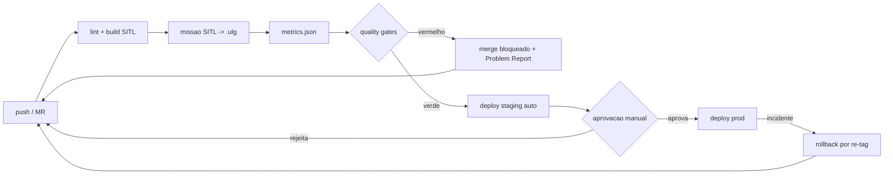

# Mapa de Cobertura do Deploy (CD) — Sprint 3

> Estende os mapas de cobertura da Sprint 2 (`projeto.md` §5.6/§5.7) ao lado de
> **deploy** (CD). Cada integração declara **contrato operacional**
> (gatilho × dado de entrada × saída esperada × critério de falha por interface),
> respondendo ao feedback do avaliador da Sprint 2 (item 1). Evidência no entorno
> imediato: as tabelas abaixo, e os arquivos `ci/*.yml` + `scripts/` citados.

## 1. Cobertura Funcional do Deploy

| Componente | Job (stage) | Onde roda | Artefato produzido |
|---|---|---|---|
| Build PX4 SITL | `sitl-mission-metrics` (build) | id=100, imagem pública px4-dev | binário `px4_sitl_default` |
| Missão simulada | `sitl-mission-metrics` (test) | mesmo job (jmavsim headless) | `.ulg` |
| Extração de métricas | `sitl-mission-metrics` (test) | mesmo job (pyulog) | `metrics.json` (artefato) |
| Quality gates | `quality-gates` (gate) | id=100 | `quality_gates_result.json` |
| Deploy staging | `deploy_staging` (deploy) | id=100 | `deploy-staging.json` + Environment |
| Deploy prod | `deploy_prod` (deploy, manual) | id=100 | `deploy-prod.json` + Environment |
| Release | `release` (deploy, tag `v*`) | id=100 | GitLab Release (checksum/SBOM) |

## 2. Contratos operacionais por integração

> Resposta direta ao feedback S2 item 1: "sem contrato operacional fechado por
> integração (gatilho, dado de entrada, saída esperada e critério de falha)".

| Integração | Gatilho | Dado de entrada | Saída esperada | Critério de falha por interface |
|---|---|---|---|---|
| `push/MR → build SITL` | push ou abertura de MR | ref git + `PX4_TAG` | binário `px4_sitl` | exit≠0 do `make` / timeout 55 min |
| `build → missão` | build concluído | binário + `mavsdk_server` | `.ulg` gerado | sem heartbeat em 30 s / arm falha / missão estoura `max_duration_s` |
| `missão → métricas` | `.ulg` presente | `.ulg` | `metrics.json` (6 KPIs) | `.ulg` ausente / erro de parsing pyulog |
| `métricas → quality gate` | `metrics.json` presente | `metrics.json` + `quality_gates.yaml` | `exit 0` (pass) / `≠0` (fail) | qualquer threshold violado |
| `gate verde → deploy staging` | pipeline verde em develop/main | artefato por `$CI_COMMIT_SHA` | `deploy-staging.json` + Environment | artefato ausente |
| `staging → prod` | clique manual (main) | mesmo artefato (mesmo SHA) | `deploy-prod.json` | aprovação negada / artefato divergente |

## 3. Cobertura Não-Funcional do Deploy

| Categoria NF | Mecanismo | Stage | Norma de referência |
|---|---|---|---|
| Imutabilidade | artefato por `$CI_COMMIT_SHA` (nunca `:latest`) | build/deploy | ISO 27001 A.8.28 |
| Rastreabilidade | `SHA ↔ commit ↔ MR ↔ issue (#TG)` | todos | DO-178C |
| Segurança (secrets) | TruffleHog/Gitleaks server-side (TG5) | sast | ISO 27001 A.5.21 |
| Análise estática (SAST) | GitLab SAST/Semgrep no runner `sonar-00` (TG5) | sast | NIST SP 800-218 |
| Integridade do artefato | checksum + SBOM no release | deploy | ISO 27001 A.8.31 |
| Tempo de feedback | duração do pipeline medida (DORA) | todos | DORA / *Accelerate* |

## 4. Thresholds por gate não-funcional

> Contrato de aceite por gate (janela × método × regra). Detalhe em
> `quality_gates.yaml` (TG6) e `docs/decisoes/0003-criterios-aprovacao-log-sitl.md`.

| Gate | Threshold | Origem | Bloqueia merge? |
|---|---|---|---|
| `coverage.min_line_coverage` | ≥ 0.55 (meta 0.80) | `quality_gates.yaml` | sim (TG6) |
| SAST new blocker/critical | 0 | `quality_gates.yaml` | informativo → sim |
| secrets verificados | 0 | TG5 | sim |
| `max_acceleration_m_s2` | ≤ 15.0 (invariante físico) | ADR-0003 | sim |
| `std_altitude_cruise_m` | ≤ 1.0 (baseline) | baseline `square_50m` | sim |
| `mission_duration_s` | ≤ 180 s (baseline) | baseline `square_50m` | sim |

## 5. Arquitetura CD (staging → promoção → rollback)

- **Artefato imutável**: artefato de CI por `$CI_COMMIT_SHA` (instância sem
  Container Registry — ver `docs/decisoes/0006-promocao-sem-registry.md`).
- **Promoção**: o MESMO artefato é re-apontado por GitLab Environment
  (dev → staging → prod), **sem rebuild** (`scripts/promote_artifact.py`).
- **"Quem aperta o botão"** (Aula 07): staging é automático (develop/main);
  prod é `when: manual` — Continuous Delivery, apropriado para firmware.
- **Rollback**: re-aponta prod a um SHA anterior (mecânica inversa, `--rollback`).
- **Release**: tag `v*` → GitLab Release com checksum/SBOM.

## 6. Malha fechada estendida ao deploy

Os gates e as métricas funcionam como **sensores** que realimentam o backlog —
o lado deploy fecha a malha do Controle em Malha Fechada da Sprint 1, agora
estendida ao CD (cada falha vira Problem Report rastreável).
