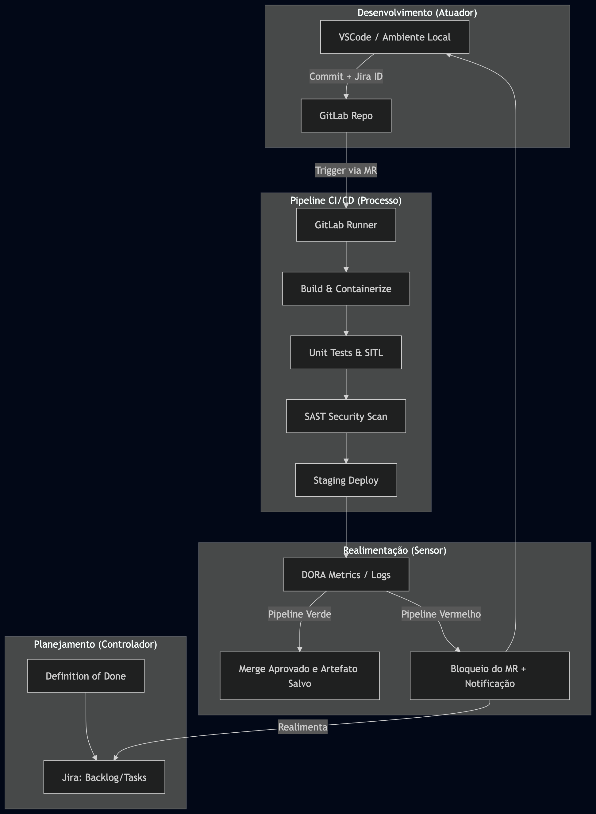

# Mapa de Cobertura da Integração

Este documento detalha o Mapa de Cobertura da Integração para o projeto **Jacto Drones OS v0.1**, servindo como referência para a arquitetura da esteira de Continuous Delivery, a infraestrutura de deploy/testes e o fluxo de trabalho adotado pela equipe.

## 1. Arquitetura da Esteira e Infraestrutura (GitLab CI/CD)

A arquitetura de integração contínua do projeto foi desenhada sob o conceito de **Sistema de Controle em Malha Fechada**. Diferente de pipelines puramente lineares, nossa esteira utiliza os resultados dos testes e da segurança como sensores que realimentam o backlog e a gestão do projeto, garantindo que o código não avance se não atender aos rigorosos critérios de qualidade de um software autônomo.

A infraestrutura é inteiramente baseada no ecossistema **GitLab**:
- **GitLab Repository:** Fonte única da verdade para o código.
- **GitLab Runners:** Nós de execução isolados (containers Docker) que processam as rotinas de build, testes (SITL/HITL) e segurança.
- **GitLab Container Registry:** Repositório de artefatos onde as imagens Docker e os binários homologados são armazenados de forma segura e versionada.

### Diagrama de Fluxo (Malha Fechada)

 

  Figura 1: Diagrama de Fluxo da Esteira em Malha Fechada 
   
  Produzido pelos autores - 2026

 

## 2. Definition of Done (DoD) Padronizado

Para garantir a coesão técnica, padronizamos o "Definition of Done" para as três frentes de engenharia do projeto. Uma tarefa só pode ser marcada como "Concluída" (Done) no Jira e mesclada na branch principal (`develop` ou `main`) se atender a 100% dos critérios abaixo:

| Categoria | Firmware (PX4/Autopilot) | Serviços (Plataforma Web) | Dados (Analytics/ETL) |
| :--- | :--- | :--- | :--- |
| **Código e Estilo** | Compilação nativa e Docker limpa. Adesão ao Google C++ Style. | Zero erros de lint (ESLint/Prettier). | Scripts/queries validados e otimizados. |
| **Testes (Coverage)** | Testes SITL via simulador Dronecode com 100% de sucesso. | Testes Jest (Unitários) e Cypress (E2E) passando sem falhas. | Testes de integridade de schemas e data quality (DQ) passando. |
| **Qualidade e Segurança**| Sem avisos críticos no `clang-tidy`. SAST aprovado (ex: SonarQube). | SAST aprovado. Sem credenciais hardcoded. | Validação de governança e segurança de acesso aprovada. |
| **Documentação** | Parâmetros documentados no código; diagramas atualizados (PlantUML). | Endpoints descritos via Swagger/OpenAPI. | Dicionário de dados e metadados atualizados no catálogo. |
| **Integração Ágil** | Commit rastreável com chave Jira; Merge Request com link para a issue. | Commit rastreável com chave Jira; Merge Request com link para a issue. | Commit rastreável com chave Jira; Merge Request com link para a issue. |
| **Revisão Humana** | Aprovação obrigatória (Peer Review) de pelo menos 1 membro sênior. | Aprovação obrigatória (Peer Review) de pelo menos 1 desenvolvedor. | Aprovação obrigatória (Peer Review) de pelo menos 1 engenheiro de dados. |

## 3. Fluxo de Integração: Do VSCode ao Backlog

A integração do trabalho técnico com a gestão ágil ocorre de maneira fluida e automatizada. Abaixo detalhamos como o código sai da máquina do desenvolvedor e transita pelo sistema:

### Fase 1: Desenvolvimento Local (VSCode)
O desenvolvedor sincroniza o repositório local com o GitLab e utiliza o **VSCode** para implementar a feature ou correção. Durante essa fase, ferramentas locais como ESLint (para web) ou clang-tidy (para C++) já operam preventivamente.

### Fase 2: Versionamento Rastreável (Conventional Commits)
Ao finalizar a tarefa, o código é "commitado" usando o padrão Conventional Commits, sendo obrigatória a inclusão da chave da respectiva tarefa do Jira.
*Exemplo:* `feat(telemetry): implementa websocket pub/sub (#JACTO-88)`

### Fase 3: Abertura do Merge Request (GitLab)
O código é enviado via `git push` para o GitLab. O desenvolvedor abre um **Merge Request (MR)** para a branch de destino (`develop` ou `main`). Essa ação muda automaticamente o status da tarefa no Jira para "In Review" através da integração nativa Jira-GitLab.

### Fase 4: Integração Contínua e Quality Gates (GitLab CI/CD)
O MR aciona o pipeline de validação. O GitLab Runner compila o código, executa a bateria de testes e faz a análise estática de vulnerabilidades.
- **Se o pipeline falhar:** O MR é bloqueado automaticamente. A integração realimenta a issue no Jira (Sensor em Malha Fechada), notificando que a tarefa requer atenção e impedindo que código quebrado afete o repositório.
- **Se o pipeline passar:** O botão de Merge é habilitado, aguardando apenas a aprovação humana (Code Review).

### Fase 5: Conclusão
Com o Code Review aprovado, o código é mesclado. O pipeline de Continuous Deployment gera o artefato imutável, o armazena no GitLab Registry, e o status da tarefa no Jira transita automaticamente para "Done", completando o ciclo.
