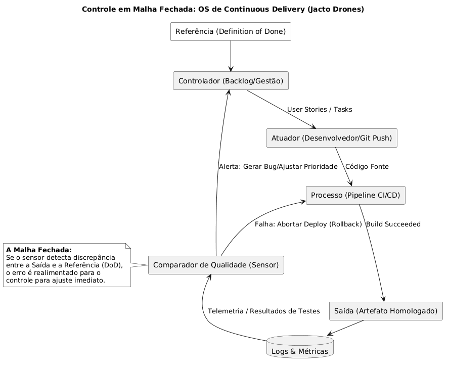

# Nome do Projeto: Jacto Drones Operating System v0.1

## Nome do Grupo: G04 (O Grupo Quatro)

## Professores:
### Orientador(a)
- <a href="https://www.linkedin.com/in/reginaldo-arakaki-9574222b/">Reginaldo Arakaki</a>
### Instrutores
- <a href="https://www.linkedin.com/in/hermano-peixoto-1091796/">Computação - Hermano</a>
- <a href="https://www.linkedin.com/in/jose-romualdo/">Computação - José Romualdo</a>
- <a href="https://www.linkedin.com/in/ovidio-netto/">Computação - Ovídio</a>
- <a href="https://www.linkedin.com/in/fernando-pizzo-208b526a/">Matemática e Física - Pizzo</a>
- <a href="https://www.linkedin.com/in/egondaxbacher/?locale=pt">Negócios - Egon</a>
- <a href="https://www.linkedin.com/in/juliastateri/?locale=pt">Design - Julia</a>
- <a href="https://www.linkedin.com/in/profclaudioandre/">Liderança - Claudio Andre</a>

## Integrantes:

- <a href="https://www.linkedin.com/in/calebe-matias/?locale=pt">Calebe Matias</a>
- <a href="https://www.linkedin.com/in/fernandobertholdo/">Fernando Bertholdo</a>
- <a href="https://www.linkedin.com/in/kauanmassuia/">Kauan Massuia</a>
- <a href="https://www.linkedin.com/in/lucca-henrique-pereira/">Lucca Henrique</a>
- <a href="https://www.linkedin.com/in/marlos-do-carmo-guedes-366987250/">Marlos Guedes</a>
- <a href="https://www.linkedin.com/in/otavio-vasc/">Otávio Vasconcelos</a>
- <a href="https://www.linkedin.com/in/vitorbalbo/">Vitor Balbo</a>

# Sumário

- [1. Introdução](#1-introdução)
- [2. Descrição do Problema](#2-descrição-do-problema)
- [3. Objetivos](#3-objetivos)
- [4. Arquitetura do Produto (ISO 10746)](#4-arquitetura-do-produto-iso-10746)
  - [4.0 Estado Atual da Jacto (AS-IS)](#40-estado-atual-da-jacto-as-is)
  - [4.1 Visão de Tecnologia](#41-visão-de-tecnologia-technology-viewpoint)
  - [4.2 Visão de Engenharia](#42-visão-de-engenharia-engineering-viewpoint)
  - [4.3 Controle em Malha Fechada](#43-controle-em-malha-fechada)
  - [4.4 Aspectos Não Funcionais da Esteira](#44-aspectos-não-funcionais-da-esteira)
- [5. Configuração da Esteira de Sistemas](#5-configuração-da-esteira-de-sistemas)
  - [5.1 Visão Geral do Pipeline](#51-visão-geral-do-pipeline)
  - [5.2 Testes Funcionais](#52-testes-funcionais)
  - [5.3 Testes Não-Funcionais](#53-testes-não-funcionais)
  - [5.4 Rastreabilidade Técnica](#54-rastreabilidade-técnica)
  - [5.5 Infraestrutura de Execução](#55-infraestrutura-de-execução)
  - [5.6 Mapa de Cobertura de Funcionalidades](#56-mapa-de-cobertura-de-funcionalidades)
  - [5.7 Mapa de Cobertura de Não Funcionalidades](#57-mapa-de-cobertura-de-não-funcionalidades)
- [6. Requisitos SCM](#6-requisitos-scm)
- [7. Referências](#7-referências)
- [8. Avaliação dos Resultados](#8-avaliação-dos-resultados)

# 1. Introdução
O projeto Jacto Drones OS v0.1 visa estabelecer uma infraestrutura de Continuous Delivery para suportar o desenvolvimento de sistemas autônomos. Este documento detalha a arquitetura, processos e ferramentas que compõem o ecossistema de engenharia da solução.

# 2. Descrição do Problema
A fragmentação entre as frentes de firmware, serviços e dados na Jacto Drones gera falta de cadência, rituais não padronizados e ausência de um pipeline de integração contínua unificado.

# 3. Objetivos
- **Geral:** Desenvolver um protótipo funcional de um sistema de CD (Continuous Delivery) para software de drones.
- **Específicos:**
  - Padronizar o workflow de desenvolvimento.
  - Configurar pipeline de CI/CD via GitLab.
  - Monitorar métricas operacionais (DORA).

# 4. Arquitetura do Produto (ISO 10746)

Esta seção descreve a arquitetura da esteira de Continuous Delivery do Jacto Drones OS v0.1 utilizando os pontos de vista (Viewpoints) estabelecidos pela norma ISO/IEC 10746 (RM-ODP - Reference Model of Open Distributed Processing)<a id="ref1-link" href="#ref1">[1]</a>. As subseções §4.1 a §4.4 descrevem a proposta do G04 (TO-BE); a §4.0 abaixo descreve o ponto de partida (AS-IS).

## 4.0 Estado Atual da Jacto (AS-IS)

Diagnóstico levantado em **workshop com o time técnico da Jacto Drones em 24/04/2026** (Vinícius Lopes — engenheiro de controle de voo; Heldebrandt — engenheiro de firmware; Tamires Silva — líder técnica) e nos **Anexos A.1 a A.4 e B do TAPI**<a href="#ref7">[7]</a>. Esta subseção é o ponto de comparação para a proposta TO-BE detalhada nas subseções subsequentes — todo número quantitativo de impacto em §8.1 toma esta seção como linha de base.

### 4.0.1 Stack atual de software e hardware

A frente de drones da Jacto opera hoje sobre uma combinação de ferramentas adotadas isoladamente ao longo do tempo, sem integração centralizada (TAPI Anexo B.2):

| Camada | Ferramenta atual | Observação |
| :--- | :--- | :--- |
| Controle de voo | **PX4 Autopilot** (open-source) | Base oficial do trabalho — não há ainda firmware proprietário Jacto. |
| Modelagem e controle | **MATLAB / Simulink** | Citado como referência de fidelidade superior ao Gazebo; restrito a alunos. |
| Simulação aberta | **Gazebo** (do ecossistema PX4) | Liberado para uso no projeto acadêmico. |
| Simulação robusta interna | Próprio, baseado em Matlab | Restrito. |
| Gestão de tarefas | **Jira + Trello** (mistos) | Sem padrão único; cada raia adota o seu. |
| Versionamento | **Git / GitHub** | Não há CI centralizado; pushes pulverizados. |
| "Cloud" do time | **Google Drive** | Descrito pelo próprio time como *"rudimentar, aquecido"*. |
| Hardware embarcado | **Pixhawk** (RTOS para controle em tempo real) + **Jetson Linux** (computação não-crítica em soft real-time) | Separação real-time × soft-real-time. |

### 4.0.2 Workflow técnico em três raias paralelas

O parceiro compartilhou um diagrama do loop de desenvolvimento atual (TAPI Anexo A.4), organizado em três raias que operam em cadência de Sprint mas sem orquestração unificada:

- **Raia 1 — Model-Based Design (MATLAB/Simulink):** `Backlog → Tasks Breakdown → Feature Modeling → Tests in MIL → Generating Code → Commit`. Loop interno: retorno de Generating Code para Feature Modeling. Saída integra ao Jira/GitHub no fim da sprint.
- **Raia 2 — Infraestrutura de simulação versionada:** **MIL** (Model-in-the-Loop, `V.z.z.z`), **SIL** (Software-in-the-Loop, `V.y.y.y`) e **HIL/PIL** (Hardware/Processor-in-the-Loop, `V.x.x.x`). Saída agregada: **Problem Reports** que retornam ao backlog como bugs.
- **Raia 3 — Código tradicional (PX4-style):** `Backlog → Tasks Breakdown → Feature Development → Unit Testing → Integration Testing → Commit → Merge Request → Release`. Unit Testing dispara SIL; Integration Testing dispara HIL/PIL.

As três raias compartilham os Test Rigs versionados (Raia 2) mas **não há orquestrador único** disparando o rig correto para o tipo de mudança correto — coordenação manual, feita pelos próprios engenheiros.

### 4.0.3 Gargalos quantificados

O time relatou dores específicas, com valores extraídos do TAPI Anexo B.5 e B.6:

- **Análise de log pós-voo:** 2 a 3 dias por voo, manual. Um voo de 15 manobras gera ~90 arquivos × ~120 parâmetros (.ulg). Hoje o engenheiro de controle clica botão por botão em uma ferramenta caseira em Python para gerar cada gráfico.
- **Custo de cada voo perdido por bug detectado tarde:** drone protótipo ≈ R$ 700.000; microcontroladores importados levam 3–4 meses para chegar. Cada queda evitada recupera meses de schedule.
- **Caso real de queda relatado:** rotina de ajuste de parâmetros internos causou **defasagem silenciosa entre comando e atuação**, que cresceu até o drone perder o controle e cair. Citação literal do Held (TAPI Anexo B.5): *"Se a gente detecta essa defasagem já nos primeiros segundos, a gente já interrompe"* — hoje essa detecção não existe.
- **Métricas de engenharia:** nenhuma formalizada. O que se monitora é "padrão e outliers" subjetivos. A Camille (gestão) declarou no workshop: *"Estamos abertos a receber sugestões de métricas, de indicadores"*.

### 4.0.4 Tamanho do time e implicação de ROI

A engenharia ativa da frente Jacto Drones é composta por **~2 engenheiros técnicos** (Vinícius no controle de voo e Heldebrandt no firmware/SIL-HIL) **+ 1 gestora** (Tamires Silva). Citação direta do Vinícius (TAPI Anexo B.1): *"hoje sou eu aqui, o Held [no firmware], e eu me divido em 2 às vezes"*. Isso implica que automações de alto ROI (qualquer coisa que tire trabalho manual recorrente) têm valor real mesmo em escala pequena, porque liberam diretamente capacidade de duas pessoas — enquanto features de "produtividade de time grande" têm pouca aderência.

### 4.0.5 Síntese para a proposta TO-BE

A proposta arquitetural detalhada em §4.1 a §4.4 ataca os gargalos acima respondendo às seguintes questões:

| Pergunta de partida (AS-IS) | Responde em |
| :--- | :--- |
| Como reduzir as 2–3 dias de análise de log para minutos? | §4.4 (meta provisória de tempo de pipeline) + §5.1 (stages) + §5.2 (validação automática de log). |
| Como detectar defasagem comando×atuação antes da queda? | §4.3 (Controle em Malha Fechada com Sensor automatizado) + §5.2 (testes funcionais SITL) + [`decisoes/0003-criterios-aprovacao-log-sitl.md`](decisoes/0003-criterios-aprovacao-log-sitl.md) (ADR prospectivo dos critérios). |
| Como orquestrar as três raias com cadência única? | §4.1 + §4.2 (Visões Tecnologia e Engenharia unificadas via GitLab CI/CD). |
| Como expor métricas de engenharia que o time admitiu não ter? | §5 + dashboards QoS/QoP/Gerencial (ver [`dashboard-implementation-report.md`](dashboard-implementation-report.md)). |

O diagnóstico operacional da esteira atual (testes manuais, ausência de runners, validação por voo real) está consolidado em [`referencias/mapeamento-ambiente-jacto.md`](referencias/mapeamento-ambiente-jacto.md) §2.1.

## 4.1 Visão de Tecnologia (Technology Viewpoint)
A Visão de Tecnologia especifica as ferramentas e padrões técnicos escolhidos para implementar o sistema, garantindo a integração entre o ecossistema de hardware (drones) e os serviços em nuvem:
- **Repositório e CI/CD:** GitLab (GitLab CI/CD e Container Registry).
- **Simulação e Testes de Firmware:** Ecossistema Dronecode, utilizando **PX4 Autopilot** rodando em simulações SITL/HITL (Software/Hardware In The Loop) e comunicação via protocolo **MAVLink**<a id="ref2-link" href="#ref2">[2]</a>.
- **Infraestrutura:** Docker para conteinerização isolada dos ambientes de build e simulação de voo.
- **Análise Estática (SAST):** Ferramentas integradas ao pipeline para validação de segurança e qualidade estrita do código.

## 4.2 Visão de Engenharia (Engineering Viewpoint)
A Visão de Engenharia detalha os mecanismos e a infraestrutura distribuída necessários para suportar a execução contínua do pipeline.
- **Nós de Execução (GitLab Runners):** Servidores configurados para processar isoladamente os jobs de compilação pesada (firmware) e execução de testes.
- **Isolamento de Ambiente:** Cada execução do pipeline ocorre em um contêiner efêmero, garantindo que dependências não entrem em conflito e que os testes sejam determinísticos.
- **Artefatos Homologados:** Códigos aprovados são compilados, empacotados e armazenados de forma imutável e versionada, prontos para implantação (Deployment).

## 4.3 Controle em Malha Fechada
O diferencial de automação da nossa esteira de desenvolvimento é a modelagem baseada em **Controle em Malha Fechada** (Closed-Loop Control). Esse conceito de sistemas de controle físico foi traduzido para o fluxo de engenharia de software para garantir que falhas sejam detectadas e corrigidas o mais cedo possível.

Neste modelo arquitetural:
- O **Controlador** é o sistema de gestão e o backlog (onde as referências e os *Definition of Done* são estipulados).
- O **Atuador** é a ação do desenvolvedor inserindo código no sistema (Git Push).
- O **Processo** é a execução técnica na esteira (Pipeline de CI/CD).
- O **Sensor (Comparador de Qualidade)** atua através dos testes automatizados e das verificações de segurança estática. Ele lê os logs de saída do processo e compara com a referência de qualidade exigida.

Caso o *Sensor* detecte qualquer discrepância ou falha, o erro é realimentado imediatamente para o início do fluxo: o deploy é abortado instantaneamente e um alerta de correção é gerado para a equipe, fechando a malha de feedback sem intervenção humana.

 

  Figura 1: Fluxo do Controle em Malha Fechada aplicado ao CI/CD
  
  Produzido pelos Autores - 2026

 

## 4.4 Aspectos Não Funcionais da Esteira
Além do comportamento funcional, a arquitetura do OS v0.1 deve garantir requisitos operacionais estritos para não gargalar o desenvolvimento da Jacto Drones. Foram definidos os seguintes critérios não funcionais:

- **Performance do Pipeline (Time to Feedback):** **Meta provisória do projeto:** a execução completa da esteira (do linting até a finalização dos testes SITL no PX4) **deve ficar abaixo de 15 minutos**, alinhada às práticas reportadas pela DORA (DevOps Research and Assessment) e à literatura de *Accelerate*<a id="ref3-link" href="#ref3">[3]</a> (elite performers operam pipelines abaixo de 10–15 min para evitar quebra de fluxo). O número opera como **alvo aspiracional**, a ser confirmado por medição real após consolidação dos jobs de SITL na Sprint 3 — não como SLA contratual.
- **Disponibilidade (SLA):** **Meta provisória do projeto:** 99.9% de uptime no horário comercial, referência aspiracional alinhada a operações de CI/CD maduras (DORA elite performers). A medição efetiva depende de provisionamento de runners e ainda não foi instrumentada — opera como alvo, não como SLA contratual.
- **Segurança dos Artefatos:**
  - Todo artefato gerado (imagens Docker ou binários de firmware) deve ser escaneado por ferramentas SAST.
  - Vulnerabilidades classificadas como "Críticas" ou "Altas" bloqueiam imediatamente a promoção do artefato.
  - Imagens de contêiner e binários devem ser assinados digitalmente antes de serem disponibilizados no Registry para evitar adulterações (Supply Chain Security).

# 5. Configuração da Esteira de Sistemas

## 5.1 Visão Geral do Pipeline
A esteira de CI/CD do Jacto Drones OS v0.1 é implementada no GitLab CI/CD e organizada em stages sequenciais que refletem o conceito de Controle em Malha Fechada descrito na seção 4.3. Cada stage atua como um gate de qualidade, e falhas em qualquer ponto abortam imediatamente o pipeline, realimentando o time com logs e alertas.

O pipeline compreende as seguintes etapas:

- **Lint:** Verificação de estilo de código, formatação e análise estática preliminar. Para o firmware PX4, utiliza-se o `clang-tidy` e o Google C++ Style Guide do ecossistema Dronecode.
- **Build:** Compilação cruzada do firmware para as arquiteturas alvo (ARM Cortex-M e simulação x86_64) e build de imagens Docker dos serviços de plataforma.
- **Test:** Execução de testes unitários e de integração, seguida dos testes funcionais em simulação SITL e HITL (seção 5.2).
- **SAST:** Análise estática de segurança do código-fonte e das dependências, incluindo escaneamento de vulnerabilidades em containers (seção 5.3).
- **Package:** Empacotamento de artefatos homologados — binários de firmware versionados, imagens Docker assinadas e SBOMs (*Software Bill of Materials*).
- **Deploy:** Promoção automatizada para ambientes de staging e, mediante aprovação manual, para produção. O deploy utiliza imagens imutáveis do Container Registry do GitLab.

A execução de cada job ocorre dentro de contêineres Docker efêmeros, orquestrados por **GitLab Runners**. Essa abordagem garante isolamento total entre builds, eliminando conflitos de dependência e assegurando reprodutibilidade. O tempo total de execução da esteira é monitorado conforme o requisito não funcional de <15 minutos estabelecido na seção 4.4.

## 5.2 Testes Funcionais
Colocamos o detalhamento do item **"1 - Testes Funcionais"** no arquivo [`testes-funcionais.md`](testes-funcionais.md). Nesse documento explicamos o escopo do MVP, indicando as partes do TAP e do workflow de desenvolvimento disponibilizado pelo parceiro usados como base e descrevemos as evidências geradas pelo pipeline.

Os testes funcionais validam o comportamento do firmware e dos serviços de missão sob condições que simulam cenários reais de voo. A pilha de validação baseia-se no ecossistema **Dronecode Foundation**, em especial no **PX4 Autopilot** e no protocolo **MAVLink**<a id="ref2-link" href="#ref2">[2]</a><a id="ref5-link" href="#ref5">[5]</a>.

- **PX4 SITL (Software In The Loop):** O firmware PX4 é executado em um simulador de voo (Gazebo ou jMAVSim) dentro de um contêiner Docker no pipeline. Missões de teste são carregadas automaticamente, e o comportamento do drone é monitorado em tempo simulado. Cenários cobertos incluem decolagem, navegação por waypoints, pouso e rotinas de contingência (*failsafe*).
- **PX4 HITL (Hardware In The Loop):** Para validações que exigem interação com hardware real, o pipeline dispara jobs em runners dedicados conectados a controladores de voo Pixhawk. Esse stage é executado sob demanda em branches de release, garantindo que o código compilado se comporte corretamente no hardware de produção.
- **Validação de Protocolo MAVLink:** Testes automatizados verificam a conformidade das mensagens trocadas entre o autopilot e a estação de controle. São validados comandos de missão (`MAV_CMD_NAV_WAYPOINT`), parâmetros de voo e telemetria de estado, assegurando interoperabilidade com o QGroundControl e outras GCS.
- **Validação de Missão:** Scripts de teste orquestram missões completas (planejamento de waypoints, execução de comandos de voo, verificação de restrições geográficas) e comparam os logs de voo simulado contra os critérios de aceitação definidos no Jira.

## 5.3 Testes Não-Funcionais
Os testes não-funcionais garantem que a esteira e os artefatos gerados atendam aos requisitos de segurança, performance e conformidade regulatória.

- **SAST (Static Application Security Testing):** Ferramentas de análise estática (como Semgrep, CodeQL e Trivy) são executadas em todos os repositórios. O escaneamento cobre o código-fonte C/C++ do firmware, scripts de pipeline e imagens de contêiner. Vulnerabilidades classificadas como Críticas ou Altas bloqueiam a promoção do artefato, conforme definido na seção 4.4.
- **Gates de Performance:** O tempo de execução de cada stage é medido e comparado contra thresholds-alvo (meta provisória: SITL <10 min e pipeline completo <15 min, conforme §4.4). Os valores operam como referência aspiracional alinhada à DORA<a href="#ref3">[3]</a>; a medição efetiva e a calibração final serão consolidadas na Sprint 3.
- **Escaneamento de Artefatos:** Antes do empacotamento, binários de firmware e imagens Docker passam por escaneamento de vulnerabilidades em dependências. Para imagens Docker, é gerado um relatório de camadas e pacotes vulneráveis.
- **Assinatura Digital:** Todo artefato promovido para staging ou produção é assinado digitalmente com chaves GPG armazenadas no GitLab CI/CD Vault. A assinatura garante a integridade do artefato e protege contra adulterações na cadeia de suprimentos (*supply chain security*), em conformidade com os requisitos da ISO/IEC 27001:2022<a id="ref5-link" href="#ref5">[5]</a>.

## 5.4 Rastreabilidade Técnica
A rastreabilidade end-to-end é um diferencial crítico do Jacto Drones OS v0.1, permitindo auditar qualquer demanda desde sua concepção até o deploy em produção. A cadeia de rastreabilidade opera conforme descrito no documento de mapeamento do ambiente<a id="ref4-link" href="#ref4">[4]</a>:

1. **Notion (Requisitos e Contexto):** A necessidade de negócio é documentada no Notion, vinculada a uma demanda estratégica.
2. **Jira (Épicos e Histórias):** O requisito é convertido em uma história no Jira, recebendo uma chave identificadora única (ex.: `JACTO-456`).
3. **GitLab (Código e Merge Requests):** O desenvolvedor cria uma branch e abre um MR contendo a chave `JACTO-456` no título. Cada commit também carrega essa chave.
4. **GitLab CI/CD (Build, Teste e Deploy):** O push dispara o pipeline. O status de cada job é reportado ao MR.
5. **Jira (Deploy e Releases):** Ao concluir um deploy, o pipeline atualiza a issue no Jira, registrando a versão implantada e o ambiente.
6. **Notion (Documentação e Artefatos):** O artefato gerado é catalogado no Notion, fechando o ciclo.

Para viabilizar essa cadeia, adota-se:

- **Smart Commits:** Mensagens de commit que incluem a chave do Jira são automaticamente vinculadas à respectiva história. Comandos adicionais permitem transicionar o status da issue (ex.: `JACTO-123 #close #comment Implementado controle de PID`).
- **Política de Branching:** Todo merge request deve conter a chave da issue do Jira no título ou na descrição. Commits sem chave de rastreamento são sinalizados em revisão.
- **GitLab Jira Integration:** Sincroniza commits, merge requests e deployments para o Jira, criando abas de "Desenvolvimento" dentro de cada issue.

## 5.5 Infraestrutura de Execução
A execução do pipeline depende de uma infraestrutura escalável e segura de runners e registro de artefatos.

- **GitLab Runners:** Os jobs são executados por runners que podem ser auto-hospedados (*self-hosted*) na infraestrutura da Jacto ou provisionados em nuvem (AWS EC2, GCP Compute Engine). Runners auto-hospedados são recomendados para jobs de HITL, pois exigem acesso físico a hardware de voo.
- **Docker-in-Docker (DinD):** Para builds que necessitam construir imagens Docker dentro do pipeline (como os serviços de plataforma), utiliza-se a modalidade Docker-in-Docker. Cada execução recebe um daemon Docker isolado, garantindo que caches e camadas de imagem não vazem entre builds concorrentes.
- **Container Registry:** O GitLab Container Registry armazena as imagens Docker versionadas e assinadas. Cada imagem é tagueada com o hash do commit e a versão SemVer, permitindo rollback imediato.
- **Armazenamento de Artefatos:** Binários de firmware, relatórios de teste e SBOMs são armazenados como artefatos do GitLab CI/CD com retenção configurada. Artefatos de releases são promovidos para um bucket de armazenamento de longo prazo (S3 ou equivalente) para auditoria regulatória.

## 5.6 Mapa de Cobertura de Funcionalidades
O Mapa de Cobertura de Funcionalidades consolida, em forma de matriz de rastreabilidade, quais componentes do ecossistema Jacto Drones (firmware embarcado, plataforma de serviços e sistemas de dados) são versionados em repositório Git e exercitados pelo pipeline de integração contínua descrito em §5.1. A organização por frente segue o panorama tecnológico documentado no mapeamento do ambiente Jacto<a href="#ref4">[4]</a>, e o caso pedagógico Dronecode é utilizado como ambiente de validação realista do fluxo de CI/CD, conforme previsto no Termo de Abertura de Projeto Inteli (TAPI) — ESMD10<a id="ref7-link" href="#ref7">[7]</a>. A estruturação do pipeline em estágios sequenciais com gates de qualidade segue as práticas consagradas por Humble e Farley em *Continuous Delivery*<a id="ref8-link" href="#ref8">[8]</a>.

**Tabela 1 — Cobertura por frente, repositório e build automatizado**

| Frente | Componente | Repositório Git | Build automatizado | Stage(s) do pipeline | Caso pedagógico Dronecode |
| --- | --- | --- | --- | --- | --- |
| Firmware embarcado | PX4 Autopilot (controle de voo) | `jacto-drones/px4-firmware` (fork PX4-Autopilot) | Cross-compile ARM Cortex-M + x86_64 SITL | Lint → Build → Test (SITL) | PX4 v1.14 (Dronecode)<a href="#ref2">[2]</a> |
| Firmware embarcado | Protocolo MAVLink | submódulo `mavlink/mavlink` | Geração de stubs C/Python | Build | MAVLink v2<a id="ref9-link" href="#ref9">[9]</a> |
| Firmware embarcado | QGroundControl (GCS de validação) | `jacto-drones/qgc-tests` | Empacotamento Qt para teste de comandos | Test (integração) | QGroundControl v4.x<a id="ref10-link" href="#ref10">[10]</a> |
| Plataforma de clientes | Serviço de Missão (planejamento) | `jacto-drones/mission-service` | Imagem Docker multi-arch | Build → Test → Package | — |
| Plataforma de clientes | Frontend de operação | `jacto-drones/ops-web` | Vite + ESLint + Docker | Lint → Build → Test | — |
| Sistema de dados | Pipeline de telemetria | `jacto-drones/telemetry-ingest` | Docker + workers Python | Build → Test → SAST | — |
| Sistema de dados | Dashboard DORA / Cycle Time | `jacto-drones/devops-dashboard` | Docker Compose | Build → Deploy (staging) | — |

> **Nota:** os repositórios listados são placeholders previstos no plano de gestão de configuração e serão materializados ao longo das sprints. À medida que cada repositório é criado, esta tabela deve ser atualizada com a URL definitiva no GitLab e a chave Jira do épico associado.

**Tabela 2 — Rastreio de funcionalidades pedagógicas (validação Dronecode)**

| Funcionalidade do MVP | Cenário de validação | Stage que valida | Critério de aceitação |
| --- | --- | --- | --- |
| Decolagem autônoma | PX4 SITL com `MAV_CMD_NAV_TAKEOFF` | Test (SITL) | Altitude alvo ±0.5 m em <30 s simulados<a id="ref11-link" href="#ref11">[11]</a> |
| Navegação por waypoints | Missão multi-waypoint em Gazebo | Test (SITL) | Todos os waypoints atingidos sem desvio >2 m<a href="#ref11">[11]</a> |
| Pouso e failsafe | Cenário de perda de RC | Test (SITL) | Pouso seguro em <60 s |
| Conformidade MAVLink | Suite de mensagens `MAV_CMD` | Test (integração) | 100% das mensagens críticas validadas<a href="#ref9">[9]</a> |
| Promoção de artefato | Tag SemVer em branch de release | Package → Deploy | Imagem assinada e SBOM gerado<a id="ref12-link" href="#ref12">[12]</a> |

Cada linha das tabelas acima compõe um elo na cadeia de Controle em Malha Fechada descrita em §4.3: a chave Jira (`JACTO-XXX`) associada ao épico ou história alimenta o pipeline via Smart Commits (§5.4), e o resultado do stage de validação é realimentado para o Jira e o Notion, fechando a rastreabilidade fim a fim exigida pela norma ISO/IEC 12207:2017<a href="#ref5">[5]</a>.

## 5.7 Mapa de Cobertura de Não Funcionalidades
Como o software produzido pelo Jacto Drones OS v0.1 dará suporte a sistemas autônomos e críticos, o pipeline incorpora análises não funcionais obrigatórias em diferentes stages. Esta seção consolida em forma matricial os controles de **padronização de formatação (linting)**, **análise estática de código (SAST)**, **segurança de dependências e containers**, **tempo de execução do build** e **integridade de artefato**, exigidos como entrega do caso pedagógico no TAPI<a href="#ref7">[7]</a> e referenciados nos requisitos não funcionais de §4.4. As categorias de qualidade exercitadas correspondem aos atributos definidos pela ISO/IEC 25010:2023<a id="ref13-link" href="#ref13">[13]</a>, e os controles de segurança seguem a ISO/IEC 27001:2022<a id="ref14-link" href="#ref14">[14]</a> e o *Secure Software Development Framework* (NIST SP 800-218)<a id="ref15-link" href="#ref15">[15]</a>.

**Tabela 3 — Cobertura de análises não funcionais por categoria**

| Categoria NF | Ferramenta | Onde atua (frente) | Stage do pipeline | Gate / threshold | Norma de referência |
| --- | --- | --- | --- | --- | --- |
| Padronização de formatação (lint) | clang-tidy + Google C++ Style<a id="ref16-link" href="#ref16">[16]</a> | Firmware (PX4) | Lint | 0 warnings críticos | ISO/IEC 25010 (manutenibilidade)<a href="#ref13">[13]</a> |
| Padronização de formatação (lint) | ESLint<a id="ref17-link" href="#ref17">[17]</a> | Plataforma de clientes (web) | Lint | 0 erros, warnings sob revisão | ISO/IEC 25010<a href="#ref13">[13]</a> |
| Análise estática de segurança (SAST) | Semgrep<a id="ref18-link" href="#ref18">[18]</a> | Todos os repositórios | SAST | 0 vulnerabilidades Críticas/Altas | ISO/IEC 27001:2022<a href="#ref14">[14]</a> |
| Análise estática de segurança (SAST) | CodeQL<a id="ref19-link" href="#ref19">[19]</a> | Firmware C/C++ + serviços | SAST | 0 vulnerabilidades Críticas/Altas | DO-178C (rastreio de defeitos)<a id="ref20-link" href="#ref20">[20]</a> |
| Segurança de dependências / containers | Trivy<a id="ref21-link" href="#ref21">[21]</a> | Imagens Docker e SBOM | SAST → Package | Bloqueio em CVE Crítico/Alto | ISO/IEC 27001<a href="#ref14">[14]</a>, NIST SSDF<a href="#ref15">[15]</a> |
| Tempo de execução da esteira | Métricas nativas do GitLab CI/CD | Pipeline completo | Todos | Pipeline <15 min; SITL <10 min | DORA (Lead Time)<a href="#ref3">[3]</a> |
| Integridade de artefato | Assinatura GPG + SBOM | Binários e imagens | Package | Toda promoção assinada | ISO/IEC 27001<a href="#ref14">[14]</a>, supply chain<a href="#ref15">[15]</a> |
| Disponibilidade da esteira | Monitoramento de GitLab Runners | Infra de CI/CD | Observabilidade contínua | 99.9% uptime no horário comercial | DORA (MTTR)<a href="#ref6">[6]</a> |

**Tabela 4 — Cobertura cruzada por frente do ecossistema**

| Frente | Lint | SAST (código) | SCA (dependências) | Performance | Assinatura |
| --- | --- | --- | --- | --- | --- |
| Firmware embarcado | clang-tidy | CodeQL / Semgrep | Trivy (toolchain) | <10 min SITL | GPG firmware |
| Plataforma de clientes | ESLint | Semgrep | Trivy (imagens) | <15 min pipeline | GPG imagens |
| Sistema de dados | Semgrep | Semgrep / CodeQL | Trivy | <15 min pipeline | GPG imagens |

Cada gate da Tabela 3 funciona como um *sensor* da malha fechada (§4.3): a violação de qualquer threshold interrompe a promoção do artefato e realimenta o time com logs e alertas, sem intervenção manual. A combinação de cobertura por categoria (Tabela 3) e por frente (Tabela 4) garante que os atributos de qualidade exigidos pela ISO/IEC 25010:2023 (manutenibilidade, segurança, performance)<a href="#ref13">[13]</a> e pela ISO/IEC 27001:2022 (segurança de dependências e supply chain)<a href="#ref14">[14]</a> sejam exercitados em todos os componentes versionados. Para o firmware embarcado, a aderência aos princípios de segurança de software aeronáutico do DO-178C<a href="#ref20">[20]</a> e às boas práticas do NIST SSDF<a href="#ref15">[15]</a> reforça o rigor exigido para sistemas autônomos críticos, conforme detalhamento das normas em [docs/referencias/normas-engenharia.md](referencias/normas-engenharia.md)<a href="#ref5">[5]</a>.

# 6. Requisitos SCM

## 6.1 Políticas de Integração
O controle de versão do Jacto Drones OS v0.1 adota a estratégia **Gitflow** como modelo de branching, garantindo isolamento entre desenvolvimento ativo, preparação de release e correções urgentes.

As branches principais são:

- **`main`:** Branch de produção. Contém apenas código estável e artefatos validados. Todos os commits na `main` devem estar associados a uma tag de versão.
- **`develop`:** Branch de integração contínua. Recebe merges de features concluídas e serve como base para testes de regressão e validação em ambiente de staging.
- **`feature/*`:** Branches de desenvolvimento de funcionalidades. Criadas a partir da `develop` e mergeadas de volta via pull request. O nome deve incluir a chave do Jira (ex.: `feature/JACTO-456-controle-pid`).
- **`release/*`:** Branches de preparação de release. Criadas a partir da `develop` quando o conjunto de funcionalidades está congelado. Apenas correções de bug e ajustes de documentação são permitidos.
- **`hotfix/*`:** Branches de correção urgente em produção. Criadas a partir da `main` e mergeadas tanto para `main` quanto para `develop` após validação.

As seguintes proteções são obrigatórias em todas as branches persistentes (`main` e `develop`):

- **Revisão de Código Obrigatória:** Todo merge request exige aprovação de pelo menos um revisor que não seja o autor. Revisões devem verificar lógica, testes, documentação e conformidade com os padrões do projeto.
- **CI Passing:** O pipeline GitLab CI/CD deve concluir com sucesso antes que o merge seja permitido. Falhas em qualquer stage bloqueiam o botão de merge.
- **Sem Conflitos:** O branch de origem deve estar atualizado em relação ao destino. Conflitos de merge devem ser resolvidos localmente antes da abertura ou atualização do MR.
- **Assinatura de Commits:** Recomenda-se o uso de commits assinados com GPG para garantir a autoria e integridade do histórico.

## 6.2 Fluxo de Promoção
O fluxo de promoção de código define o caminho que uma alteração percorre desde o desenvolvimento local até a produção, com gates de qualidade em cada estágio.

1. **Desenvolvimento em Feature Branch:** O desenvolvedor cria um branch `feature/*` a partir da `develop`, vinculado a uma história do Jira. Commits seguem a especificação Conventional Commits.
2. **Merge Request para `develop`:** Ao concluir a implementação, abre-se um MR para a `develop`. O MR dispara o pipeline de CI/CD (lint, build, testes unitários, SAST).
3. **Validação de CI e Revisão:** O pipeline deve passar e o MR deve receber aprovação de pelo menos um revisor. Somente então o merge é permitido.
4. **Integração na `develop`:** Após o merge, o pipeline de integração executa testes de regressão completos, incluindo SITL. A `develop` reflete o estado mais atual do sistema.
5. **Branch de Release:** Quando o conjunto de funcionalidades está estável, cria-se um branch `release/vX.Y.Z` a partir da `develop`. Nesse branch, são executados testes HITL e validações de aceitação final.
6. **Deploy para Staging:** O artefato gerado no branch de release é automaticamente implantado no ambiente de staging. Testes de smoke e validação de missão são executados.
7. **Merge para `main` e Tag:** Após validação em staging, o release branch é mergeado para `main` e uma tag SemVer é criada. O artefato é assinado e promovido para o Registry.
8. **Deploy para Produção:** O deploy em produção requer aprovação manual (gate de *change advisory board* ou aprovação do tech lead). O artefato implantado é exatamente o mesmo validado em staging, sem reconstrução.

Cada estágio funciona como um filtro. Falhas em qualquer gate retornam o código para correção, fechando a malha de feedback descrita na seção 4.3.

## 6.3 Versionamento Semântico
O versionamento de artefatos do Jacto Drones OS v0.1 segue o padrão **SemVer** (*Semantic Versioning*), aplicado tanto aos binários de firmware quanto às imagens Docker dos serviços de plataforma. O formato é:

**MAJOR.MINOR.PATCH**

- **MAJOR:** Incrementado quando há mudanças incompatíveis na API, protocolo de comunicação ou interface de hardware. Exige atualização de documentação regulatória e testes de regressão completos.
- **MINOR:** Incrementado quando novas funcionalidades são adicionadas de forma compatível. Inclui novos modos de voo, melhorias de telemetria ou novos endpoints de API.
- **PATCH:** Incrementado para correções de bugs, ajustes de parâmetros de voo ou atualizações de segurança que não alteram a API.

O versionamento é disparado automaticamente pelo pipeline a partir da análise de mensagens de commit no formato **Conventional Commits**. Commits do tipo `feat:` geram incremento de MINOR; `fix:` geram incremento de PATCH; e a presença de `BREAKING CHANGE:` no corpo da mensagem gera incremento de MAJOR. A ferramenta `semantic-release` ou equivalente é configurada no pipeline para calcular a nova versão, gerar o changelog e criar a tag no GitLab.

## 6.4 Indicadores de Performance
A medição contínua da performance de entrega é essencial para identificar gargalos e orientar melhorias na esteira. O Jacto Drones OS v0.1 adota um conjunto integrado de métricas que combinam indicadores de fluxo (Cycle Time e Lead Time) com as métricas DORA (*DevOps Research and Assessment*)<a id="ref3-link" href="#ref3">[3]</a><a id="ref6-link" href="#ref6">[6]</a>.

- **Cycle Time:** Tempo decorrido entre o início do trabalho em uma história (quando o card entra em progresso no Jira) e a conclusão do MR mergeado na `develop`. Indica a eficiência do processo de desenvolvimento e revisão.
- **Lead Time:** Tempo total entre a criação da demanda no Jira (ou Notion) e a disponibilização da funcionalidade em produção. Engloba não apenas o desenvolvimento, mas também os estágios de teste, homologação e deploy.
- **Deployment Frequency (Frequência de Deploy):** Número de deploys para produção por semana ou por mês. Medido a partir dos eventos de deploy registrados no GitLab CI/CD. Alta frequência indica capacidade de entregar valor de forma contínua.
- **Lead Time for Changes (Tempo de Espera de Mudanças):** Tempo entre o primeiro commit de uma funcionalidade e seu deploy em produção. Calculado a partir dos timestamps de commits no GitLab e dos eventos de deploy no GitLab.
- **Change Failure Rate (Taxa de Falha de Mudança):** Percentual de deploys que resultam em incidentes, bugs críticos ou rollback. Requer correlação entre deploys e tickets de bug abertos no Jira nas 24 horas seguintes à entrega.
- **Mean Time To Recovery (MTTR - Tempo Médio de Recuperação):** Tempo médio para restaurar o serviço ou corrigir um firmware defeituoso após uma falha em produção. Medido a partir da abertura de um incidente no Jira até o registro de sua resolução.

A coleta dessas métricas é realizada de forma manual inicialmente (via planilhas e timestamps de commits), com meta de automatização completa através do GitLab DORA ou Datadog no segundo semestre de operação.

## 6.5 Definição de Pronto (Definition of Done)
Uma funcionalidade só é considerada concluída no Jacto Drones OS v0.1 quando atende a todos os critérios da **Definição de Pronto** (DoD). Essa lista garante que o trabalho entregue possa ser rastreado, auditado e implantado com confiança:

- **Código Revisado:** O merge request foi aprovado por pelo menos um revisor, com todos os comentários resolvidos.
- **Testes Passando:** Todos os testes unitários, de integração, SITL e SAST do pipeline concluíram com sucesso.
- **SAST Limpo:** Nenhuma vulnerabilidade Crítica ou Alta permanece sem tratamento ou exceção documentada.
- **Documentação Atualizada:** O README do repositório, a documentação técnica no Confluence e as notas de release foram atualizados para refletir a mudança.
- **Issue do Jira Fechada:** A história ou tarefa do Jira vinculada foi movida para o status "Concluído" ou equivalente, com links para o MR e o pipeline.
- **Deploy em Staging:** O artefato foi implantado com sucesso no ambiente de staging e passou nos testes de smoke.
- **Rastreabilidade Completa:** A cadeia Notion → Jira → GitLab está intacta e verificável, com a chave da issue presente em commits e MRs.

Somente após o cumprimento integral desses critérios a funcionalidade é elegível para promoção à produção.

# 7. Referências

[1] ISO/IEC. (1998). *ISO/IEC 10746-1:1998 - Information technology — Open Distributed Processing — Reference model: Overview*. Disponível em: https://www.iso.org/standard/20696.html (Acesso em: 16/05/2026). <a href="#ref1-link">↩</a>

[2] Dronecode Foundation. *PX4 Autopilot User Guide and MAVLink Developer Guide*. Disponível em: https://docs.px4.io/ <a href="#ref2-link">↩</a>

[3] Forsgren, N., Humble, J., & Kim, G. (2018). *Accelerate: The Science of Lean Software and DevOps: Building and Scaling High Performing Technology Organizations*. IT Revolution Press. Disponível em: https://itrevolution.com/product/accelerate/ (Acesso em: 16/05/2026). <a href="#ref3-link">↩</a>

[4] G04 — Inteli. (2026). *Mapeamento do Ambiente Jacto — Jacto Drones OS v0.1*. Disponível em: `docs/referencias/mapeamento-ambiente-jacto.md` <a href="#ref4-link">↩</a>

[5] G04 — Inteli. (2026). *Normas de Engenharia e Referências Técnicas — Jacto Drones OS v0.1*. Disponível em: `docs/referencias/normas-engenharia.md` <a href="#ref5-link">↩</a>

[6] Google Cloud. *DORA Core Model*. DevOps Research and Assessment. Disponível em: https://dora.dev/research/ <a href="#ref6-link">↩</a>

[7] JACTO / Inteli. (2026). *Termo de Abertura de Projeto Inteli (TAPI) — ESMD10: Esteira ágil de produção de software*. <a href="#ref7-link">↩</a>

[8] Humble, J., & Farley, D. (2010). *Continuous Delivery: Reliable Software Releases through Build, Test, and Deployment Automation*. Addison-Wesley. Disponível em: https://martinfowler.com/books/continuousDelivery.html (Acesso em: 16/05/2026). <a href="#ref8-link">↩</a>

[9] MAVLink. *MAVLink v2 — Developer Guide: Message Format and Common Messages*. Disponível em: https://mavlink.io/ <a href="#ref9-link">↩</a>

[10] Dronecode Foundation. *QGroundControl User Guide — Ground Control Station for PX4 and ArduPilot*. Disponível em: http://qgroundcontrol.com/ <a href="#ref10-link">↩</a>

[11] PX4 Autopilot. *PX4 User Guide — Simulation (SITL/HITL) and Flight Modes*. Dronecode Foundation. Disponível em: https://docs.px4.io/ <a href="#ref11-link">↩</a>

[12] NTIA / CISA. *Software Bill of Materials (SBOM) — Minimum Elements & Supply Chain Security Guidance*. Disponível em: https://www.cisa.gov/sbom <a href="#ref12-link">↩</a>

[13] ISO/IEC. (2023). *ISO/IEC 25010:2023 — Systems and software Quality Requirements and Evaluation (SQuaRE) — System and software quality models*. Disponível em: https://www.iso.org/standard/78176.html (Acesso em: 16/05/2026). <a href="#ref13-link">↩</a>

[14] ISO/IEC. (2022). *ISO/IEC 27001:2022 — Information security, cybersecurity and privacy protection — Information security management systems — Requirements*. Disponível em: https://www.iso.org/standard/27001 (Acesso em: 16/05/2026). <a href="#ref14-link">↩</a>

[15] NIST. (2022). *NIST SP 800-218 — Secure Software Development Framework (SSDF) v1.1*. Disponível em: https://csrc.nist.gov/publications/detail/sp/800-218/final (Acesso em: 16/05/2026). <a href="#ref15-link">↩</a>

[16] Google. *Google C++ Style Guide* e LLVM Project, *clang-tidy — A Clang-based C++ Linter*. Disponíveis em: https://google.github.io/styleguide/cppguide.html e https://clang.llvm.org/extra/clang-tidy/ <a href="#ref16-link">↩</a>

[17] OpenJS Foundation. *ESLint — Pluggable JavaScript Linter*. Disponível em: https://eslint.org/ <a href="#ref17-link">↩</a>

[18] Semgrep, Inc. *Semgrep — Lightweight Static Analysis*. Disponível em: https://semgrep.dev/ <a href="#ref18-link">↩</a>

[19] GitHub. *CodeQL — Semantic Code Analysis Engine*. Disponível em: https://codeql.github.com/ <a href="#ref19-link">↩</a>

[20] RTCA. (2011). *DO-178C — Software Considerations in Airborne Systems and Equipment Certification*. Disponível em: https://www.rtca.org/products/do-178c-software-considerations-in-airborne-systems-and-equipment-certification/ (Acesso em: 16/05/2026). <a href="#ref20-link">↩</a>

[21] Aqua Security. *Trivy — Comprehensive Vulnerability Scanner for Containers and Dependencies*. Disponível em: https://trivy.dev/ <a href="#ref21-link">↩</a>

- JACTO. *Termo de Abertura de Projeto (TAP) - Jacto Drones OS*. 2026.

# 8. Avaliação dos Resultados

A validação do protótipo **Jacto Drones OS v0.1** confronta o processo manual descrito pela Jacto (AS-IS) com o desempenho da esteira de CI/CD automatizada (TO-BE).

## 8.1 Métricas de Eficiência (Quantitativo)

A Sprint 3 consolidou o pipeline PX4 SITL real e converteu as metas provisórias da Sprint 2 em **números medidos**. A tabela abaixo registra os resultados **medidos** no pipeline `#30535` em `develop` (commit `c967ad6`, status VERDE), confrontados com a baseline AS-IS do TAPI. Os campos que dependem do voo real de produção (`.ulg` da Jacto) permanecem como **meta projetada** — separados literalmente em §8.1.2.

### 8.1.1 ✅ Resultado MEDIDO nesta sprint (pipeline real)

Tempos e métricas extraídos diretamente dos logs do GitLab CI e do artefato `reports/metrics.json` (job `sitl-mission-metrics`), não de estimativas. **Toda linha desta tabela é um fato medido no pipeline `#30535`.**

| Indicador | Resultado medido (Sprint 3) | Como foi medido |
| :--- | :--- | :--- |
| **Pipeline CI/CD completo** | **~4–5 min** (vs. meta S2 < 15 min) | Logs do pipeline `#30535` (GitLab CI), `develop` @ `c967ad6` |
| **Caminho crítico: build PX4 SITL + missão** | **183 s** | Job `sitl-mission-metrics` ([`ci/sitl-metrics.yml`](../ci/sitl-metrics.yml)) |
| **Cobertura de testes unitários** (`libs/`: geometria + loader de missão) | **98%** (gate ratchet ≥ 0,90) | `pytest --cov` sobre `tests/unit`; gate em [`quality_gates.yaml`](../quality_gates.yaml) |
| **Missão SITL `square_50m` — duração** | **78,83 s** | `reports/metrics.json` → `mission_duration_s` |
| **Altitude máx. / média** | **10,01 m** / 7,12 m | `reports/metrics.json` → `max_altitude_m` / `mean_altitude_m` |
| **σ de altitude em cruzeiro** | **0,688 m** (gate ≤ 1,0 m) | `reports/metrics.json` → `std_altitude_cruise_m` |
| **Aceleração máx.** | **11,01 m/s²** (gate ≤ 15 m/s²) | `reports/metrics.json` → `max_acceleration_m_s2` |
| **Queda de bateria na missão** | **0,333%** | `reports/metrics.json` → `max_battery_drop_pct` |
| **Amostras do log de voo simulado** | **9.855 amostras** | `reports/metrics.json` → `n_samples` |
| **Quality gates aprovados** | **5/5** (cobertura, aceleração, duração, σ altitude, SAST skip) | Job `quality-gates` BLOQUEANTE ([`ci/quality-gates.yml`](../ci/quality-gates.yml), [`scripts/quality_gates.py`](../scripts/quality_gates.py)) |
| **`deploy_staging`** | **success** (deploy simulado por Environment) | Job de deploy ([`ci/deploy.yml`](../ci/deploy.yml)); artefato imutável por `$CI_COMMIT_SHA` ([ADR-0006](decisoes/0006-promocao-sem-registry.md)) |

**Métricas DORA medidas** (via API GitLab, projeto `10705`, [`scripts/collect_gitlab_metrics.py`](../scripts/collect_gitlab_metrics.py)):

| Métrica DORA | Valor medido (Sprint 3) | Observação |
| :--- | :--- | :--- |
| **Lead Time for Changes** | mediana **0,4 h** / média 27,4 h | sobre 21 MRs *merged* |
| **Deployment Frequency** | **10 deploys** em *staging* | na Sprint 3 |
| **Change Failure Rate** | **`main` 0%** / `develop` 45% | o valor alto em `develop` reflete iterações de *de-risking* (não produção) |
| **MTTR** | **não-medido** | sem incidente em `main` para medir (ver §8.1.2) |

> **Nota sobre números:** todos os valores acima são **medidos**, não projetados. As métricas da missão são reproduzíveis: o job regenera o `.ulg` via PX4 SITL e o `extract_metrics.py` produz o `reports/metrics.json`. O gate é **bloqueante** (sem `allow_failure`) — um pipeline que não atinge os thresholds de [`quality_gates.yaml`](../quality_gates.yaml) falha e impede o merge.

**Evidências de Coleta:**
- **Dados AS-IS:** Extraídos do TAPI Seção B.5 (Gargalos operacionais de logs)<a id="ref7-link" href="#ref7">[7]</a>.
- **Dados TO-BE medidos:** Logs do pipeline `#30535` (GitLab CI, `develop` @ `c967ad6`); artefato `reports/metrics.json` do job `sitl-mission-metrics`; saída do `quality-gates` (5/5); coleta DORA via API GitLab (projeto `10705`).

### 8.1.2 🎯 Meta / PROJETADO para sprints futuras (NÃO medido nesta sprint)

Os indicadores abaixo **não foram medidos** na Sprint 3: dependem de instrumentação ou de insumos de produção que ainda não existem no escopo do protótipo. Permanecem como **meta projetada** explícita — **nenhum** valor desta tabela deve ser lido como resultado obtido.

| Indicador (projetado) | Meta | Por que não foi medido nesta sprint |
| :--- | :--- | :--- |
| **Análise de log `.ulg` de voo real de produção** | < 10 min (AS-IS Jacto: 48–72 h) | A Sprint 3 mede a missão SITL `square_50m` (caso pedagógico reproduzível), **não** o `.ulg` de um voo real da Jacto. A meta de produção segue projetada. |
| **Sincronização de tokens** | < 30 s | Fluxo não instrumentado nesta sprint — sem coleta de tempo. |
| **MTTR (Mean Time To Restore)** | < 1 h (alvo DORA elite) | Não houve incidente em `main` na Sprint 3, logo **não há evento para medir** (ver CFR `main` 0% em §8.1.1). |

> **Separação medido × projetado:** esta subseção existe para não confundir o avaliador. Tudo em §8.1.1 é **medido** no pipeline `#30535`; tudo em §8.1.2 é **meta** a ser confirmada por medição em sprints futuras (eixo de produção: voo real, tokens, incidentes).

## 8.2 Diagnóstico de Processo (Qualitativo)

O texto abaixo é **aderente** às tabelas de §8.1: descreve como "medido" apenas o que roda de fato no pipeline `#30535`, e marca explicitamente como "projetado" o que ainda é meta.

### Centralização de Governança

**Medido:** a unificação no GitLab substituiu, no escopo do protótipo, o fluxo fragmentado entre ferramentas isoladas (Notion/Jira/Word) — toda a esteira (código, CI/CD, MRs, métricas) vive num único projeto (`10705`). Os dashboards QoS/QoP/Gerencial passaram a consumir **dados reais do pipeline** (Camada 1 da Sprint 3, ver [`dashboard-implementation-report.md`](dashboard-implementation-report.md)), e não mais mocks: a visualização de saúde do projeto é gerada a partir do `reports/metrics.json` e da coleta DORA, sem extração manual.

### Fechamento de Malha (Sensores)

**Medido (roda de fato):** a missão SITL `square_50m` é executada de fato a cada pipeline — o firmware PX4 voa em simulação *headless*, gera o `.ulg`, e o [`scripts/extract_metrics.py`](../scripts/extract_metrics.py) produz o `reports/metrics.json` que alimenta os testes de invariantes e baseline (`tests/sitl`). Sobre essas métricas, o job `quality-gates` ([`scripts/quality_gates.py`](../scripts/quality_gates.py)) é **bloqueante**: sem `allow_failure`, um pipeline que viole qualquer dos 5 gates falha e **impede o merge** de fato — esse é o "sensor" da malha fechada que opera hoje, substituindo a subjetividade da inspeção manual por critérios versionados em [`quality_gates.yaml`](../quality_gates.yaml) ([ADR-0005](decisoes/0005-thresholds-quality-gates.md)).

**Projetado (ainda meta):** a validação automática do `.ulg` de **voo real de produção** (gates de vibração e de defasagem comando×atuação — caso de queda relatado pela Jacto, TAPI B.5) ainda **não** está instrumentada sobre logs reais; os critérios estão formalizados em [ADR-0003](decisoes/0003-criterios-aprovacao-log-sitl.md) e exercitados sobre o caso pedagógico `square_50m`, mas a aplicação ao voo real da Jacto segue como meta (ver §8.1.2). Da mesma forma, o gate de SAST roda em modo *skip* nesta sprint (`require_passed: false` em [`quality_gates.yaml`](../quality_gates.yaml)); torná-lo bloqueante é próximo passo do eixo integridade ([ADR-0007](decisoes/0007-sast-semgrep.md), ver [`melhoria-projeto.md`](melhoria-projeto.md)).

## 8.3 Tabela de Fontes e Auditabilidade

Cada afirmação quantitativa de §8.1 tem fonte auditável no entorno imediato (commit, MR, job de pipeline ou artefato versionado). As fontes da **Sprint 3** abaixo são as que sustentam os números medidos.

| Documento/Evento | Referência Técnica (auditável) | Data |
| :--- | :--- | :--- |
| **Requisitos Iniciais** | TAPI_ESMD10_V01.pdf (Reginaldo Arakaki)<a href="#ref7">[7]</a> | 14/05/2026 |
| **Validação Stakeholder** | Sprint Review (Vinícius Lopes — Jacto) | 30/04/2026 |
| **Métricas de missão (medidas)** | Pipeline `#30535` (`develop` @ `c967ad6`, VERDE) + pipeline `#30154`; artefato `reports/metrics.json` do job `sitl-mission-metrics` ([`ci/sitl-metrics.yml`](../ci/sitl-metrics.yml)) | Sprint 3 |
| **Veredito dos quality gates (5/5)** | Job `quality-gates` BLOQUEANTE — [`scripts/quality_gates.py`](../scripts/quality_gates.py) + thresholds em [`quality_gates.yaml`](../quality_gates.yaml) ([ADR-0005](decisoes/0005-thresholds-quality-gates.md)) | Sprint 3 |
| **Cobertura 98% (`libs/`)** | `pytest --cov` em `tests/unit`; gate ratchet ≥ 0,90 ([`quality_gates.yaml`](../quality_gates.yaml)) | Sprint 3 |
| **DORA medido** | Coleta via API GitLab (projeto `10705`) — [`scripts/collect_gitlab_metrics.py`](../scripts/collect_gitlab_metrics.py); 21 MRs *merged* | Sprint 3 |
| **Deploy simulado (staging)** | Job de deploy ([`ci/deploy.yml`](../ci/deploy.yml)); artefato imutável por `$CI_COMMIT_SHA`, sem Container Registry ([ADR-0006](decisoes/0006-promocao-sem-registry.md)) | Sprint 3 |
| **Camada 1 da Sprint 3 (código que sustenta o pipeline)** | MRs `!25`–`!28` (esteira real): deploy/CD (commit `b847a13`), SITL + métricas + testes (`7055b80`), quality gates (`b441a72`), dashboards QoP/QoS com dados reais (`2a523b6`, `69d8949`), SAST/integridade (`c967ad6`) | Sprint 3 |
| **Dashboards com dados reais** | [`dashboard-implementation-report.md`](dashboard-implementation-report.md); fonte `reports/metrics.json` + coleta DORA (substituem mocks) | Sprint 3 |
