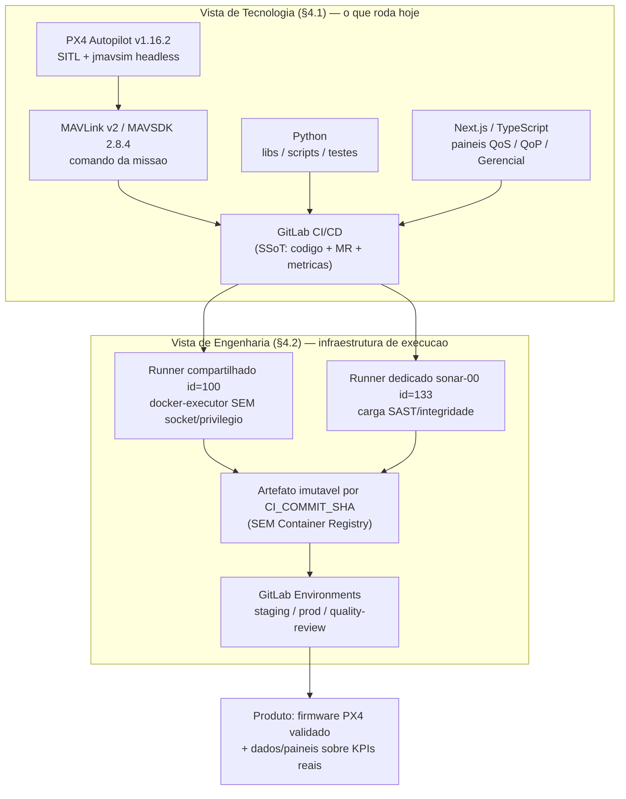
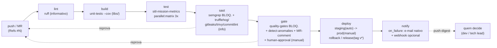
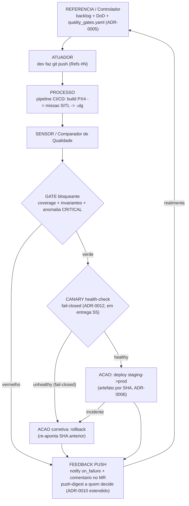

# Relatório Executivo — Jacto Drones OS v0.1 (Esteira de CI/CD)

> **Grupo G04 · Sprint 5 · Módulo 10 (Inteli)**
> Entregável avaliado (peso 9). Confronta o processo manual da Jacto (**AS-IS**)
> com a esteira de Continuous Delivery automatizada que o grupo construiu sobre
> PX4 SITL (**TO-BE**), e propõe o caminho de produção.
>
> **Princípio do relatório — evidência no entorno imediato.** Cada número aparece
> ao lado da sua fonte auditável (pipeline #, tag, artefato versionado, ADR). O
> que **não** foi medido no protótipo é marcado **`[projetado]`** e nunca lido
> como resultado. Tudo aqui é lastreado em `docs/projeto.md` §4–§8,
> `evidence/`, `docs/decisoes/0001`–`0011`, `ci/*.yml`, `scripts/` e
> `src/src/data/*.json` — sem invenção de indicador.
>
> **Nota de transparência sobre vintages de snapshot.** Convivem dois cortes de
> coleta DORA, ambos versionados e reportados lado a lado: o **corte da Sprint 3**
> (pipeline `#30535`, `src/src/data/dora.json`, coletado `2026-05-29`) e o
> **corte reauditável da Sprint 4** (`evidence/dora.json` + `evidence/raw/`,
> coletado `2026-06-13`). Os números mudam entre cortes porque a amostra cresceu;
> a metodologia (`scripts/collect_gitlab_metrics.py`) é idêntica.

---

## Sumário

- [1. Contexto e leitura executiva](#1-contexto-e-leitura-executiva)
- [2. Diagnóstico Inicial — os 4 mapas](#2-diagnóstico-inicial--os-4-mapas)
  - [2.1 Mapa 1 — Automações de testes e deploy](#21-mapa-1--automações-de-testes-e-deploy-as-is--to-be)
  - [2.2 Mapa 2 — Arquitetura do Sistema](#22-mapa-2--arquitetura-do-sistema-iso-10746)
  - [2.3 Mapa 3 — Automação de Integração e Deploy](#23-mapa-3--automação-de-integração-e-deploy-cicd)
  - [2.4 Mapa 4 — Controle em Malha Fechada da Esteira](#24-mapa-4--controle-em-malha-fechada-da-esteira)
- [3. Esteira de CI/CD e Indicadores](#3-esteira-de-cicd-e-indicadores)
  - [3.1 Testes funcionais (dev/deploy)](#31-indicadores-de-testes-funcionais-devdeploy)
  - [3.2 Indicadores de produto (dev/deploy)](#32-indicadores-de-produto-devdeploy)
  - [3.3 Indicadores de processo (dev/deploy)](#33-indicadores-de-processo-devdeploy)
  - [3.4 Indicadores gerais](#34-indicadores-gerais)
  - [3.5 Estado AVALIADO vs. estado ATUAL](#35-estado-avaliado-0612-vs-estado-atual-v061)
- [4. Recomendações](#4-recomendações)
  - [4.1 Treinamento (Arquitetura e Processo)](#41-treinamento-arquitetura-e-processo)
  - [4.2 Arquitetura e Processo + roadmap de produção](#42-arquitetura-e-processo--roadmap-de-produção)
- [5. Limites pedagógicos (fora de escopo)](#5-limites-pedagógicos-honestidade-de-escopo)

---

## 1. Contexto e leitura executiva

A frente de drones da Jacto opera hoje com **~2 engenheiros técnicos + 1 gestora**
(`projeto.md` §4.0.4, TAPI Anexo B.1), três raias de desenvolvimento sem
orquestrador único (Model-Based/MATLAB, Test Rigs MIL/SIL/HIL, código PX4-style —
`projeto.md` §4.0.2) e **análise de log de voo `.ulg` 100% manual**: 2 a 3 dias por
voo, ~90 arquivos × ~120 parâmetros por voo de 15 manobras (`projeto.md` §4.0.3,
TAPI B.5). O custo de um bug detectado tarde é literal: drone protótipo ≈
**R$ 700.000**, microcontroladores importados com 3–4 meses de lead time. Houve
**queda real** por defasagem silenciosa comando×atuação que não foi detectada a
tempo (citação do Held, TAPI B.5).

O G04 entregou um **protótipo funcional de Continuous Delivery** (objetivo geral,
`projeto.md` §3) sobre o ecossistema Dronecode (PX4 + MAVLink), em GitLab CI/CD,
que **executa de fato a missão SITL a cada pipeline**, extrai métricas do `.ulg`
real e **bloqueia o merge** quando um invariante físico é violado. A leitura
executiva, em uma linha:

> A esteira converteu a inspeção manual de 2–3 dias em um **veredito automático em
> ~4–5 min** sobre o caso pedagógico reproduzível `square_50m`, com cada número
> auditável no próprio repositório — e já estendeu a malha até **canary
> health-check + notificação push** do resultado a quem decide (entrega desta
> Sprint 5).

**O que NÃO se afirma:** que o número de 2–3 dias → minutos vale para o `.ulg` de
**voo real de produção** da Jacto. A esteira mede `square_50m` (caso didático); a
aplicação ao voo real segue **`[projetado]`** (`projeto.md` §8.1.2).

---

## 2. Diagnóstico Inicial — os 4 mapas

Os quatro mapas exigidos pela rubrica. Cada um separa **AS-IS** (Jacto, hoje) de
**TO-BE** (o que o protótipo do G04 executa), com a fronteira do que é real
explicitada.

### 2.1 Mapa 1 — Automações de testes e deploy (AS-IS → TO-BE)

Matriz do que **mudou de manual para automático**. Estado: **OPERACIONAL (S3/S4)**
= roda no pipeline real, com evidência no entorno imediato; **`[projetado]`** =
meta de sprints futuras / produção.

| Automação | AS-IS (Jacto) | TO-BE (protótipo G04) | Estado | Evidência (entorno imediato) |
|---|---|---|---|---|
| Validação de log de voo | Clique a clique em ferramenta caseira Python; 2–3 dias | Missão SITL roda no CI → `.ulg` → `metrics.json` automático | **OPERACIONAL (S3)** | `ci/sitl-metrics.yml` (job `sitl-mission-metrics`); `scripts/extract_metrics.py`; pipeline `#30535`, `#40688` |
| Testes unitários (domínio) | Ad hoc / inexistente formal | `pytest --cov` sobre `libs/`, gate ratchet ≥ 0,90 (medido **98%**) | **OPERACIONAL (S3), BLOQUEANTE** | `tests/unit/`, `ci/sitl-metrics.yml` (job `unit-tests`), `quality_gates.yaml` |
| Testes de integração SITL | Coordenação manual do Test Rig | Invariantes físicos + baseline sobre o `.ulg` (`tests/sitl`) | **OPERACIONAL (S3), BLOQUEANTE** | `tests/sitl/`, `ci/sitl-metrics.yml`; ADR-0003 |
| Detecção de anomalia | Subjetiva ("padrão e outliers", §4.0.3) | 4 regras server-side; **VIBRATION SPIKE > 1,5 g bloqueia o merge** | **OPERACIONAL (S4), BLOQUEANTE** | `ci/anomaly.yml`, `scripts/detect_anomalies.py`, ADR-0009 |
| SAST / segredos | Hooks Husky client-side (puláveis com `--no-verify`) | Server-side no CI; **Semgrep bloqueante** (severidade ERROR) | **OPERACIONAL (S4)** | `ci/sast.yml` (semgrep, trufflehog, gitleaks, trivy), ADR-0007 |
| Deploy / promoção | Pushes pulverizados, sem promoção formal | Artefato imutável por `$CI_COMMIT_SHA` promovido por Environment (staging auto → prod manual) | **OPERACIONAL (S3), simulado** | `ci/deploy.yml`, `scripts/promote_artifact.py`, ADR-0006 |
| Rollback | Inexistente formal | `rollback_prod` re-aponta prod a um `ROLLBACK_SHA` anterior | **OPERACIONAL (S3), simulado** | `ci/deploy.yml` (job `rollback_prod`) |
| Release versionado | Tag manual sem rastro | Tag `v*` → **GitLab Release real** (release-cli) por SHA | **OPERACIONAL (S3)** | `ci/deploy.yml` (job `release`); tag `v0.6.0`, pipeline `#40692` |
| Notificação do resultado | Feedback "puxado" (abrir UI) | `notify` no `on_failure` (e-mail nativo + webhook opcional) → **push-digest a quem decide** | **OPERACIONAL (S4)** + push em entrega (S5) | `ci/notify.yml`, ADR-0010 (estendido nesta sprint) |
| Canary health-check | Inexistente | Health-check fail-closed antes de promover (sensor→ação) | **EM ENTREGA (S5)** `[projetado p/ métrica]` | ADR-0012 (em paralelo nesta sprint) |
| Multi-cliente | N/A | `parallel:matrix` — mesmo firmware × N perfis de missão | **OPERACIONAL (S4), PoC** | `ci/sitl-metrics.yml` (`parallel:matrix`), ADR-0011 |

> **Honestidade (Mapa 1).** Deploy/rollback/canary são **simulados** (`deploy_kind:
> "simulado"`, ADR-0006): registram a promoção por Environment, sem cluster real
> por trás. O alvo real (k8s/OpenChoreo) é roadmap (§4.2).

### 2.2 Mapa 2 — Arquitetura do Sistema (ISO 10746)

Arquitetura da esteira pelos viewpoints da ISO/IEC 10746 (RM-ODP), conforme
`projeto.md` §4. Vista de Tecnologia × Engenharia × o produto exercitado.

**Restrições de infraestrutura que viraram decisão (não buraco silencioso).** Um
spike de de-risking (pipelines `30001`/`30004`/`30040`/`30065`, ADR-0006) mediu
duas restrições da instância Inteli (GitLab CE 18.6.1): (1) **não há Container
Registry** (`CI_REGISTRY` vazio em runtime); (2) o runner `id=100` é
**docker-executor sem socket/privilégio** (nada de `docker build/run`/DinD). Disso
nasceu o modelo "artefato de CI imutável por `$CI_COMMIT_SHA` + deploy simulado por
Environment" (ADR-0006), e os scanners rodam em modo **filesystem** (`trivy fs`,
`trivy config`, trufflehog/gitleaks `dir`) em vez de `trivy image`.

| Camada (AS-IS, §4.0.1) | Jacto hoje | TO-BE no protótipo |
|---|---|---|
| Controle de voo | PX4 (sem firmware proprietário) | PX4 v1.16.2 exercitado via SITL no CI |
| Versionamento | Git/GitHub, sem CI central | **GitLab como SSoT** + CI/CD unificado (ADR-0001) |
| "Cloud" do time | Google Drive ("rudimentar") | Projeto GitLab `10705` único (código+CI+métricas) |
| Gestão de tarefas | Jira + Trello mistos | Issues do GitLab (#2–#7) + `Refs #N` + commitlint |
| Métricas de engenharia | Nenhuma formalizada | DORA medido via API + painéis QoS/QoP/Gerencial |

### 2.3 Mapa 3 — Automação de Integração e Deploy (CI/CD)

Topologia real do pipeline (`.gitlab-ci.yml` + fragmentos por concern `ci/*.yml`,
incluídos por glob — cada membro adiciona o seu sem editar o root). Os 7 stages, na
ordem que executa: **lint → build → test → sast → gate → deploy → notify**.

**Contrato operacional por integração** (gatilho × entrada × saída × critério de
falha) — extraído de `docs/mapa-cobertura-deploy.md` §2:

| Integração | Gatilho | Entrada | Saída esperada | Critério de falha |
|---|---|---|---|---|
| `push/MR → build SITL` | push/MR | ref git + `PX4_TAG` | binário `px4_sitl` | exit≠0 do `make` / timeout 55 min |
| `build → missão` | build ok | binário + `mavsdk_server` | `.ulg` gerado | sem heartbeat 30 s / arm falha / estoura `max_duration_s` |
| `missão → métricas` | `.ulg` presente | `.ulg` | `metrics.json` (KPIs) | `.ulg` ausente / erro pyulog |
| `métricas → quality gate` | `metrics.json` | `metrics.json` + `quality_gates.yaml` | `exit 0` (pass) | qualquer threshold violado |
| `gate verde → deploy staging` | pipeline verde (develop/main) | artefato por SHA | `deploy-staging.json` + Environment | artefato ausente |
| `staging → prod` | clique manual (main) | mesmo SHA | `deploy-prod.json` | aprovação negada / artefato divergente |
| `tag v* → release` | push de tag `v[0-9]*` | SHA + tag | GitLab Release real | tag sem pipeline verde / erro release-cli |
| `incidente → rollback` | manual com `ROLLBACK_SHA` | SHA anterior | `deploy-prod.json` (`rollback:true`) | `ROLLBACK_SHA` vazio / SHA inválido |

**Promoção sem rebuild (ADR-0006).** Promover = **re-apontar o MESMO artefato por
SHA**, nunca recompilar. O ciclo RC → staging → aprovação humana → prod → rollback
→ release está auditado passo a passo em `evidence/ciclo-cd/README.md`, cada passo
deixando um manifesto JSON (`reports/deploy-*.json`, `reports/release-<tag>.json`)
gerado por `scripts/promote_artifact.py`.

### 2.4 Mapa 4 — Controle em Malha Fechada da Esteira

O diferencial arquitetural (`projeto.md` §4.3): o controle físico de malha fechada
traduzido para o fluxo de engenharia. **Sensor → decisão → ação → feedback**, agora
**estendido nesta Sprint 5** com o laço novo: missão SITL → métricas/anomalias →
gate → **canary health-check (fail-closed)** → deploy/rollback → **notificação push
do resultado a quem decide**.

**Mapeamento sensor → decisão → ação → feedback (o que fecha a malha HOJE):**

| Elemento de controle | Implementação real | Bloqueia? | Evidência |
|---|---|---|---|
| **Referência** | `quality_gates.yaml` (thresholds versionados) | — | ADR-0005 |
| **Atuador** | `git push` + `Refs #N` (Conventional Commits) | — | commitlint, `ci/sast.yml` |
| **Processo** | missão SITL real a cada pipeline (não mock) | — | `ci/sitl-metrics.yml`; pipeline `#40688` |
| **Sensor (gate)** | `quality_gates.py`: coverage + invariantes + anomalia CRITICAL | **SIM** | `scripts/quality_gates.py`, ADR-0005/0009 |
| **Sensor (anomalia)** | `detect_anomalies.py`: VIBRATION SPIKE > 1,5 g | **SIM** | `ci/anomaly.yml`, ADR-0009 |
| **Decisão (canary)** | health-check fail-closed antes de promover | em entrega S5 | ADR-0012 `[métrica projetada]` |
| **Ação (deploy/rollback)** | promoção por SHA / `rollback_prod` | manual em prod | `ci/deploy.yml`, ADR-0006/0008 |
| **Feedback (push)** | `notify` on_failure + comentário no MR + push-digest | nunca bloqueia | `ci/notify.yml`, ADR-0010 |

> **Laço novo desta sprint, honesto.** **Canary (ADR-0012)** e a extensão
> **push-digest (ADR-0010)** estão sendo entregues **em paralelo nesta Sprint 5**
> por outras frentes do grupo; este relatório os referencia como peças da malha
> **em entrega**, não como números medidos. As métricas de canary/push são
> **`[projetado]`** até consolidação. O que **já fecha a malha hoje** são os gates
> bloqueantes (cobertura, invariantes, anomalia CRITICAL) + o `notify` on_failure
> + o comentário automático no MR.

A diferença prática para o AS-IS: a queda relatada pela Jacto (defasagem
comando×atuação silenciosa, §4.0.3) é o tipo de evento que um **sensor automático**
pega "nos primeiros segundos" (citação do Held). Hoje o protótipo exercita esse
sensor sobre `square_50m`; o gate de defasagem sobre voo **real** é `[projetado]`
(ADR-0003, `projeto.md` §8.2).

---

## 3. Esteira de CI/CD e Indicadores

As 4 classes de indicadores exigidas pela rubrica, **só com números encontrados nos
arquivos**, cada um com fonte. Onde há dois vintages de coleta (Sprint 3 ×
Sprint 4), ambos aparecem.

### 3.1 Indicadores de testes funcionais (dev/deploy)

Missão SITL `square_50m` — cliente canônico `jacto_ref` (`ci/sitl-metrics.yml`).
Valores **medidos** do `metrics.json` real do `.ulg` (corte Sprint 3, pipeline
`#30535`, confirmados no snapshot `src/src/data/metrics.json`):

| Indicador funcional | Valor medido | Gate | Fonte |
|---|---|---|---|
| Duração da missão | **78,83 s** | ≤ 180 s | `metrics.json` → `mission_duration_s`; pipeline `#30535` |
| Altitude máx / média | **10,01 m** / 7,12 m | — | `metrics.json` → `max_altitude_m`/`mean_altitude_m` |
| σ de altitude em cruzeiro | **0,688 m** | ≤ 1,0 m | `metrics.json` → `std_altitude_cruise_m` |
| Aceleração máx | **11,01 m/s²** | ≤ 15 m/s² | `metrics.json` → `max_acceleration_m_s2` |
| Queda de bateria na missão | **0,333 %** | — | `metrics.json` → `max_battery_drop_pct` |
| Amostras do log simulado | **9.855** | > 0 (anti-degenerado) | `metrics.json` → `n_samples` |
| Anomalias detectadas (último run) | **0** | 0 CRITICAL (bloqueante) | `src/src/data/anomalies.json` (real, recalibrado `2026-06-16`); ADR-0009 |
| **Caminho crítico** build PX4 + missão | **183 s** | — | job `sitl-mission-metrics`, pipeline `#30535` |
| **Pipeline CI/CD completo** | **~4–5 min** (vs. meta S2 < 15 min) | — | logs do pipeline `#30535` (`develop` @ `c967ad6`) |

- **Cobertura de funcionalidade do deploy** (dev→deploy): a trilha funcional
  cobre build SITL → missão → métricas → gate → staging → prod → release →
  rollback, 8 integrações com contrato fechado (`docs/mapa-cobertura-deploy.md`
  §1–§2).
- **Multi-cliente (PoC)**: `parallel:matrix` roda **3 execuções** (`jacto_ref`
  canônico + `cliente_a` + `cliente_b`), cada uma gerando `metrics-<cliente>.json`
  real do seu `.ulg` (ADR-0011). Só `jacto_ref` alimenta o gate (é a missão
  calibrada).

### 3.2 Indicadores de produto (dev/deploy)

Qualidade do artefato produzido e promovido.

| Indicador de produto | Valor | Estado | Fonte |
|---|---|---|---|
| Cobertura de testes unitários (`libs/`) | **~98%** | gate ratchet ≥ 0,90, **BLOQUEANTE** | `pytest --cov`, pipeline `#30535`/`#40688`; `quality_gates.yaml` |
| Quality gates aprovados | **5/5** (S3) → **4/4** (S4) | **BLOQUEANTE** | job `quality-gates`; corte S4 em `src/src/data/pipeline-snapshot.json` (gates 4/4 PASS) |
| Anomalias CRITICAL no artefato | **0** | bloqueia se ≥ 1 | `ci/anomaly.yml`, ADR-0009 |
| Achados SAST reais corrigidos | **2** (Dockerfile sem USER não-root; XML parse sem `defusedxml`) | Semgrep **BLOQUEANTE** (ERROR) | `src/src/data/pipeline-snapshot.json` (`sast`); `ci/sast.yml`, ADR-0007 |
| Imutabilidade do artefato | por `$CI_COMMIT_SHA` (nunca `:latest`) | OPERACIONAL | ADR-0006; `docs/mapa-cobertura-deploy.md` §3 |
| Último release de produto | **v0.6.0** (pipeline `#40692`, MR `!43`) | GitLab Release real | `src/src/data/pipeline-snapshot.json` (`audit_refs`) |

> **Nota S3→S4 sobre o conjunto de gates.** No corte da Sprint 3 o veredito era
> **5/5** (cobertura, aceleração, duração, σ-altitude, SAST-skip). No corte da
> Sprint 4 o snapshot consolidado reporta **4/4 PASS** (cobertura, aceleração,
> duração, σ-altitude) com o **SAST promovido a bloqueante no próprio stage `sast`**
> (Semgrep ERROR) em vez de contar como check "skip" no gate — daí a contagem
> 4/4. Ambos são pipelines verdes; a diferença é de **onde** o SAST é enforçado, não
> de regressão (`ci/sast.yml`, `src/src/data/pipeline-snapshot.json`).

### 3.3 Indicadores de processo (dev/deploy)

Métricas DORA, **medidas via API GitLab** (`scripts/collect_gitlab_metrics.py`,
projeto `10705`). Dois cortes versionados:

| Indicador DORA | Corte Sprint 3 (`#30535`, `2026-05-29`) | Corte Sprint 4 (`evidence/`, `2026-06-13`) | Classificação | Fonte |
|---|---|---|---|---|
| **Lead Time for Changes** | mediana **0,4 h** / média 27,4 h (21 MRs) | mediana **0,2 h** / média 17,7 h (**33 MRs**) | `elite` | `src/src/data/dora.json` / `evidence/dora.json` |
| **Deployment Frequency** | **10 deploys** staging | **20 deploys** staging (23 total) | `medium` (conservador) | idem; `evidence/process-metrics.json` |
| **Change Failure Rate — `main` (produção)** | **0%** | **0%** (7 pipelines, 0 falhas) | `elite` | idem |
| **Change Failure Rate — `develop` (de-risking)** | 45% | **21%** (24 total, 5 failed) | reportado à parte | idem |
| **MTTR** | **não-medido** | **não-medido** | — | `main` 0 falhas (nada a recuperar) |

- **Amostra de pipelines (corte S4):** 100 pipelines = **42 success / 26 failed /
  23 skipped / 5 canceled** (`evidence/process-metrics.json`).
- **Honestidade DORA** (`docs/dora-protocolo.md`, `evidence/README.md`): amostra
  **pequena** e de **ambiente pedagógico**; o CFR alto de `develop` reflete
  **iterações de de-risking** (spike SITL), **não** incidente de produção — por
  isso `main` (0%) é o proxy de produção e `develop` é reportado só por
  transparência. MTTR é declarado **não-medido** em vez de inventado.
- **Reauditável sem credencial:** qualquer terceiro recomputa os 4 indicadores a
  partir de `evidence/raw/*.json` com `collect_gitlab_metrics.py --from-evidence`
  (sem token, sem rede) — fecha o feedback do avaliador S3 sobre "não conseguir
  reexecutar a validação pela API" (`evidence/README.md`).

**Rastreabilidade de processo (dev):** issues do GitLab `#2`–`#7` (uma por TG) +
Conventional Commits + `Refs #N`, validados por commitlint (`projeto.md` §5.4). A
extensão Notion → Jira → GitLab é `[projetado]`.

### 3.4 Indicadores gerais

| Indicador geral | Valor | Estado | Fonte |
|---|---|---|---|
| Time to feedback (pipeline completo) | **~4–5 min** | vs. meta provisória < 15 min (§4.4) | pipeline `#30535` |
| Disponibilidade (SLA) | 99,9% (alvo) | **`[projetado]`** — não instrumentado | `projeto.md` §4.4 |
| Tempo de análise de log `.ulg` de **voo real** | < 10 min (alvo; AS-IS 48–72 h) | **`[projetado]`** | `projeto.md` §8.1.2 |
| Sincronização de tokens | < 30 s (alvo) | **`[projetado]`** — fluxo não instrumentado | `projeto.md` §8.1.2 |
| Stages do pipeline | **7** (lint→build→test→sast→gate→deploy→notify) | OPERACIONAL | `.gitlab-ci.yml` |
| Fragmentos por concern (`ci/*.yml`) | **7** (sitl-metrics, sast, quality-gates, anomaly, deploy, notify, mr-kpis) | OPERACIONAL | `ci/` |
| ADRs registradas | **11** (0001–0011) + 0012 em entrega | OPERACIONAL | `docs/decisoes/` |
| Última pipeline verde em `develop` | **`#40688`** (Sprint 4: matrix 3x + gate + anomalia + SAST) | success | `src/src/data/pipeline-snapshot.json` |

### 3.5 Estado AVALIADO (~06-12) vs. estado ATUAL (v0.6.1+)

Tabela que a rubrica pede: o que **entrou depois do corte do review**, e como cada
item responde a um desconto da nota avaliada.

> **Procedência da nota.** A nota **8,3/10** (Deploy **3,0**; QoS/QoP **3,6**;
> Resultados **1,7**) é o **feedback da Sprint review** transmitido ao grupo. Ela
> **não consta em arquivo versionado** do repositório — é a baseline qualitativa
> contra a qual medimos o delta abaixo. *(Ver gap em §5: o card de rubrica
> `cards-da-semana/semana_10.json` citado no escopo não está presente no repo.)*

| Eixo (nota avaliada) | Estado AVALIADO (~06-12) | Estado ATUAL (v0.6.x) — o que entrou | Responde ao desconto? |
|---|---|---|---|
| **Resultados (1,7)** | Telemetria do dashboard era **mock**; métrica de missão pouco lastreada | Telemetria SITL **real** (`flight-telemetry.json` do `.ulg`); painéis QoS/QoP consomem KPI real, sem mock | **Sim** — o que era "fabricado" virou dado medido auditável (`dashboard-implementation-report.md`, `ci/sitl-metrics.yml`) |
| **Resultados (1,7)** | Sem pacote reauditável; avaliador não reexecutou DORA sem token | `evidence/raw/` + `--from-evidence`: reauditoria **sem credencial** | **Sim** — fecha literalmente o feedback S3 (`evidence/README.md`) |
| **QoS/QoP (3,6)** | SAST **informativo** (não reprovava) | Semgrep **bloqueante** (ERROR); **2 findings reais corrigidos** | **Sim** — segurança deixou de ser cosmética (`ci/sast.yml`, ADR-0007) |
| **QoS/QoP (3,6)** | Anomalia só no dashboard (inspeção humana) | Anomalia **server-side no gate**; VIBRATION SPIKE bloqueia merge | **Sim** — sensor inevitável, não puxado (`ci/anomaly.yml`, ADR-0009) |
| **Deploy (3,0)** | Deploy simulado, 1 perfil de missão | **Matrix multi-cliente** (mesmo firmware × N missões reais) | **Parcial** — amplia cobertura; ainda simulado (PoC, ADR-0011) |
| **Deploy (3,0)** | Promoção sem laço final de saúde nem aviso push | **Canary health-check** (fail-closed) + **push-digest** do resultado a quem decide | **Em entrega (S5)** — fecha o laço sensor→ação→feedback (ADR-0012, ADR-0010 estendido) `[métrica projetada]` |

---

